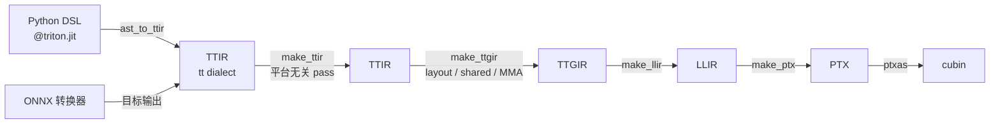
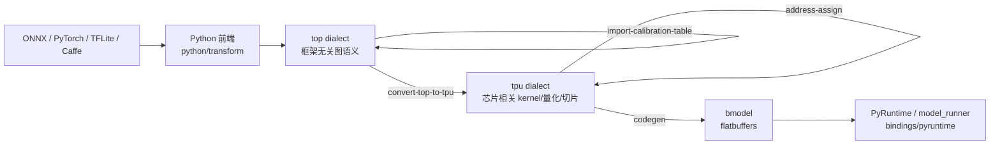
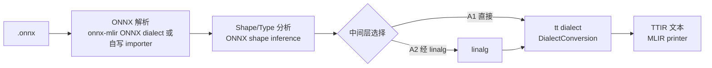
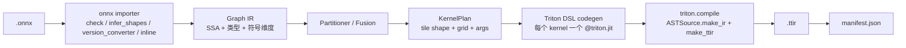
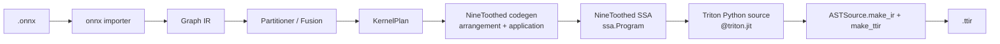

# ONNX → Triton IR 转换：一手资料调研与工程建议

- 日期：2026-11-13（初版 2026-11-09；2026-11-12 增补 `/root/ninetoothed` 与 `/root/InfiniOps`；2026-11-13 增补 TPU-MLIR 调研）
- 范围：ONNX 模型到 Triton IR（TTIR）的转换器架构选型，与 Triton 相邻的 DSL / 算子库生态，以及 TPU-MLIR 这一“ONNX → MLIR → 目标方言 → 目标二进制”的工业先例
- 方法：优先阅读本机源码（`/root/triton`、`/root/onnx-mlir`、`/root/triton-shared`、`/root/triton-linalg`、`/root/FlagTree`、`/root/PaddleTritonOps`、`/root/nkct`、`/root/llvm-project`、`/root/ninetoothed`、`/root/InfiniOps`、`/root/tpu-mlir-master`），再核对官方文档与规范，并检索社区项目。另做了若干最小实测（见 §1.2 与附录 A）。star/PyPI 元数据于 2026-11-12 读取 GitHub REST API 与 PyPI JSON API；TPU-MLIR 的 GitHub 元数据于 2026-11-13 读取。
- 论文来源：TPU-MLIR 相关的两篇论文（[Hu22] arXiv:2210.15016、[Hu26b] arXiv:2607.15865）由 Undermind 工作区 `3b3b20e4-1a7e-441c-bbfc-eaaa3c1ab060` 的 `/TPU-MLIR/` 文件夹提供；本报告对论文声称与当前源码实现分别标注。
- 说明：本报告不引用任何既有内部 PoC 或其产物；所有结论仅基于本机一手源码、官方规范与本报告的独立实测。
- 证据标记：
  - **【源码】** 本机源码可直接确认，给出 `路径:行号`
  - **【文档】** 官方文档/规范确认，给出 URL
  - **【实测】** 本报告在 2026-11-09 实际运行验证
  - **【检索】** 基于 2026-11-09 初版与 2026-11-12 增补的网络检索，可能遗漏
  - **【推断】** 基于以上事实的工程判断，不是事实陈述
- 版本说明：本报告的 Triton 源码行号以 `/root/triton`（**3.6.0**）为准；本机实际安装的是 **3.8.0**。两者符号名与管线结构基本一致，但行号会偏移（例如 `add_stages` 在 3.8.0 中位于 `backends/nvidia/compiler.py:598`，在 3.6.0 中位于 `third_party/nvidia/backend/compiler.py:556`）。引用时请以符号名为主、行号为辅。
- 增补版本：NineToothed 本地为 **0.26.0**（PyPI 同版本发布于 2026-06-30，本地 HEAD `4295e9c` 领先该 tag 36 个提交）；InfiniOps 本地为 **0.1.0**（无 release tag，HEAD `8b63a0f` 日期 2026-11-11）。
- 2026-11-13 增补版本：TPU-MLIR 本地为 `/root/tpu-mlir-master`（无 `.git`，无法给出 commit）；GitHub `sophgo/tpu-mlir` 的 `pushed_at` 为 **2026-11-03**，本报告把它视作“2026-11 的 master 快照”。论文 [Hu22] 发表于 2022-10，二者相隔约四年，文中凡涉及新功能处均单独标注“当前 master”。

---

## 目录

- [0. 结论摘要](#0-结论摘要)
- [1. “Triton IR”到底是什么](#1-triton-ir到底是什么)
  - [1.1 TTIR / TTGIR / LLIR / PTX / cubin 的层级关系](#11-ttir--ttgir--llir--ptx--cubin-的层级关系)
  - [1.2 如何得到 TTIR](#12-如何得到-ttir)
  - [1.3 TTIR 的结构与硬约束](#13-ttir-的结构与硬约束)
  - [1.4 TTIR 是否稳定，是否适合作为输出契约](#14-ttir-是否稳定是否适合作为输出契约)
- [2. ONNX 侧输入模型](#2-onnx-侧输入模型)
  - [2.1 onnx.proto 的基本结构](#21-onnxproto-的基本结构)
  - [2.2 opset 与版本漂移](#22-opset-与版本漂移)
  - [2.3 initializer 与常量](#23-initializer-与常量)
  - [2.4 shape inference 与动态维度](#24-shape-inference-与动态维度)
  - [2.5 控制流算子 If / Loop / Scan](#25-控制流算子-if--loop--scan)
  - [2.6 对转换器的直接影响](#26-对转换器的直接影响)
- [3. 现有实现盘点](#3-现有实现盘点)
  - [3.1 本地仓库逐个定位](#31-本地仓库逐个定位)
  - [3.2 社区项目现状](#32-社区项目现状)
  - [3.3 盘点结论](#33-盘点结论)
  - [3.4 NineToothed 与 InfiniOps 深入调研](#34-ninetoothed-与-infiniops-深入调研)
  - [3.5 TPU-MLIR：ONNX → MLIR → TPU 的端到端编译器](#35-tpu-mlironnx--mlir--tpu-的端到端编译器)
- [4. 可行架构方案对比](#4-可行架构方案对比)
  - [4.1 方案 A：基于 MLIR 的 ONNX → TTIR](#41-方案-a基于-mlir-的-onnx--ttir)
  - [4.2 方案 B：生成 Triton Python DSL，再编译得到 TTIR](#42-方案-b生成-triton-python-dsl再编译得到-ttir)
  - [4.3 方案 C：逐算子手写 Triton kernel + 运行时图调度](#43-方案-c逐算子手写-triton-kernel--运行时图调度)
  - [4.4 方案 D：间接路线（StableHLO/XLA 或 PyTorch/Inductor）](#44-方案-d间接路线stablehloxla-或-pytorchinductor)
  - [4.5 横向对比](#45-横向对比)
- [5. 关键技术难点](#5-关键技术难点)
- [6. MVP 建议](#6-mvp-建议)
- [7. 推荐路线与主要风险](#7-推荐路线与主要风险)
- [8. 参考来源](#8-参考来源)
- [附录 A：本次实测记录](#附录-a本次实测记录)
- [附录 B：缩略语与术语表](#附录-b缩略语与术语表)

---

## 0. 结论摘要

1. **“Triton IR”在工程上通常指 TTIR**：它是 MLIR 的 `tt` dialect（外加 `arith`/`math`/`scf` 等），硬件无关、tile 级。TTIR 之后还有 TTGIR（GPU layout/共享内存/MMA）、LLIR（LLVM dialect）、PTX、cubin。TTIR 是“最合适作为转换器输出”的层级，因为布局与调度尚未绑定到具体 GPU。【源码】`/root/triton/include/triton/Dialect/Triton/IR/TritonDialect.td:7`
2. **TTIR 可以被文本化、被重新解析、被编译**：`triton.compile("x.ttir")` 会从 TTGIR 阶段继续编译；本报告实测把一份 `.ttir` 编到了 sm70 的 cubin。【源码】`/root/triton/python/triton/compiler/compiler.py:87,226,292`【实测】
3. **但 TTIR 不是稳定 ABI**：Triton 官方文档没有给出 TTIR 的版本化/兼容性承诺，`tt` dialect 的 op 集合直接由 `TritonOps.td` 定义并随版本变化；`triton.compile` 甚至不在公开 Python API 文档的索引里。因此 TTIR 适合做“绑定 Triton 版本的编译产物契约”，不适合做“跨版本稳定的公共接口”。【源码】【文档】【推断】
4. **ONNX 侧没有现成的 ONNX → Triton 路径**：onnx-mlir 的 `ONNXToLinalg` 目前只支持 2D×2D MatMul 和受限的 4D Conv；其主力路径是 ONNX → Krnl → affine/LLVM（CPU 导向）。【源码】`/root/onnx-mlir/src/Conversion/ONNXToLinalg/Math/MatMul.cpp:7-14`、`NN/Conv.cpp:9-16`
5. **社区没有成熟的 ONNX → Triton IR 开源项目**：`triton-shared` 与 `triton-linalg` 都是反方向（Triton → Linalg）；`NKCT/CKTI` 是 CUDA → Triton IR；`PaddleTritonOps` 是 Triton 算子库；FlagTree 是多后端 Triton 分支；ONNX Runtime 只是把预编译的 Triton kernel 嵌进 EP，并不做图级转换。最接近的工业级先例是 XLA:GPU 的 Triton fusion emitter（HLO → TTIR）。【检索】【源码】
   - **2026-11-12 增补**：新调研的 NineToothed 是“Triton 之上的张量元编程 DSL / 多后端 kernel 生成器”，InfiniOps 是“跨平台 C++ 算子库”。两者分别处在 kernel 生成层和算子执行层，都没有 ONNX 图前端，也不直接产出 TTIR，因此不改变上述结论（详见 §3.4）。【源码】【检索】
6. **推荐路线：B-first, A-ready**。先用“Python 图 IR + 生成 Triton DSL + 调 Triton 前端产出 TTIR”的方案拿到正确、可验证的 TTIR，再保留把 codegen 后端替换为 MLIR pass（方案 A）的接口。输出契约建议为“**每个 kernel 一个 `.ttir` 文件 + 一份 manifest.json**”，而不是一个巨大的单文件 TTIR。
   - **2026-11-12 增补**：NineToothed 不构成独立方案，只构成 B 的可选前端变体 B′（§4.2.1）。v0 仍直接生成 Triton Python；把 `KernelPlan → 源码` 做成可替换接口，以便未来插入 B′。InfiniOps 不进入 v0 依赖，只在“多硬件执行 ONNX 图”成为产品目标时评估（§7.1）。
7. **2026-11-13 增补：TPU-MLIR 是“ONNX → MLIR → 目标方言 → 目标二进制”的成熟工业先例，但不是 ONNX → Triton 的实现**。它用两层方言把“框架无关的图语义（`top`）”与“芯片相关的 kernel/内存/量化（`tpu`）”分开，中间用 op interface 与分阶段 pass 衔接，并在每一层做数值验证；这套骨架对方案 A 的可行性是强证据，对方案 B 的 Graph IR/验证设计也有直接借鉴价值。但它的 target dialect、codegen 接口、layer group、内存分配与 bmodel/PyRuntime 全部绑定 SOPHGO TPU，**不能**直接复用到 Triton 后端。因此本报告的两条核心结论——“社区没有成熟的 ONNX → Triton IR 开源实现”与“B-first, A-ready”——**均不改变**（详见 §3.3、§3.5）。【源码】【检索】【推断】

---

## 1. “Triton IR”到底是什么

### 1.1 TTIR / TTGIR / LLIR / PTX / cubin 的层级关系

Triton 的编译管线在 NVIDIA backend 里被显式建模为一张 `stages` 表。`add_stages` 按顺序注册 `ttir`、`ttgir`、`llir`、`ptx`、`cubin` 五个阶段：

【源码】`/root/triton/third_party/nvidia/backend/compiler.py:556-565`

```python
stages["ttir"]  = lambda src, metadata: self.make_ttir(...)
stages["ttgir"] = lambda src, metadata: self.make_ttgir(...)
stages["llir"]  = lambda src, metadata: self.make_llir(...)
stages["ptx"]   = lambda src, metadata: self.make_ptx(...)
stages["cubin"] = lambda src, metadata: self.make_cubin(...)
```

| 层级 | 文件扩展名 | 内容 | 硬件相关性 | 生成函数 |
|---|---|---|---|---|
| TTIR | `.ttir` | `tt` dialect + `arith`/`math`/`scf`/`cf`；tile 级张量运算、指针运算、`tt.dot`/`tt.reduce` | 硬件无关 | `make_ttir` |
| TTGIR | `.ttgir` | 给张量分配 layout（`#ttg.blocked`、`#ttg.mma` 等）、共享内存、warp 划分；`ttg.` 系列 op | GPU 相关 | `make_ttgir` |
| LLIR | `.llir` | LLVM dialect（`llvm.` 系列） | 目标相关 | `make_llir` |
| PTX | `.ptx` | NVIDIA PTX 汇编 | NVIDIA 相关 | `make_ptx` |
| cubin | `.cubin` | 可加载的 GPU 二进制 | 架构相关 | `make_cubin` |

- TTIR 阶段跑的是平台无关 pass：inliner、tensor pointer 重写、canonicalize、combine、reorder broadcast、CSE、symbol DCE、loop unroll。【源码】`/root/triton/third_party/nvidia/backend/compiler.py:235-250`
- TTGIR 阶段才引入 `convert_to_ttgpuir`、coalesce、accelerate matmul、pipeline 等 GPU 相关优化。【源码】`/root/triton/third_party/nvidia/backend/compiler.py:252-347`
- 对 ONNX 转换器而言，**TTIR 是正确的输出层级**：如果直接产出 TTGIR，就必须提前决定 layout、`num_warps`、共享内存和具体架构，等于把后端职责揽到自己身上。【推断】



### 1.2 如何得到 TTIR

有四条可操作路径，按“与 Triton 版本的耦合程度”从低到高排列。

#### 路径 1：Python DSL → `triton.compile` → 读 `CompiledKernel.asm["ttir"]`

`compile()` 会把每个阶段的产物放进 cache，并在 `CompiledKernel` 里暴露为 `asm` 字典：

【源码】`/root/triton/python/triton/compiler/compiler.py:226-330`、`:426-430`

```python
import triton
from triton.backends.compiler import GPUTarget

src = triton.compiler.ASTSource(
    fn=my_kernel,
    signature={"x_ptr": "*fp32", "n": "i32"},
    constexprs={"BLOCK": 128},
)
k = triton.compile(src, target=GPUTarget("cuda", 70, 32))
print(k.asm["ttir"])   # 文本形式
```

这是最“官方语义”的方式：TTIR 由 Triton 自己的 AST→IR 前端生成，广播、类型提升、mask、指针运算都由前端处理。【源码】`/root/triton/python/triton/compiler/code_generator.py:1620`（`ast_to_ttir`）

同时可以用环境变量把每个阶段的 IR dump 到磁盘：

- `TRITON_KERNEL_DUMP=1`
- `TRITON_DUMP_DIR=<dir>`

【源码】`/root/triton/python/triton/knobs.py:345,358`；【文档】`/root/triton/README.md:237-238`

#### 路径 2：只跑前端 + `make_ttir`，不需要 ptxas/GPU

如果目标只是产出 TTIR，不必把整条管线跑到 cubin。可以直接调用 `ASTSource.make_ir` 和 backend 的 `make_ttir`：

【源码】`/root/triton/python/triton/compiler/compiler.py:52-85`（`ASTSource.make_ir`）、`/root/triton/third_party/nvidia/backend/compiler.py:235`

```python
from triton._C.libtriton import ir
from triton.compiler import ASTSource
from triton.compiler.compiler import make_backend
from triton.backends.compiler import GPUTarget

target = GPUTarget("cuda", 70, 32)
backend = make_backend(target)
options = backend.parse_options({})
ctx = ir.context(); ir.load_dialects(ctx); backend.load_dialects(ctx)

src = ASTSource(fn, signature=..., constexprs=...)
module = src.make_ir(target, options, backend.get_codegen_implementation(options),
                     backend.get_module_map(), ctx)
ttir = backend.make_ttir(module, {}, options, 70)   # 返回 ir.module
text = str(ttir)
```

本报告实测这条路径在 **不依赖 `ptxas`、也没有触发 GPU driver 调用** 的情况下成功产出了 TTIR 文本（见附录 A.1）。【实测】

#### 路径 3：直接读取 `.ttir` 文件并编译

`compile()` 接受字符串路径。如果路径以 `.ttir` 结尾，会走 `IRSource`：

- `IRSource` 用 `ir.parse_mlir_module(path, context)` 解析；
- 取模块里的 entry function（第一个 `public` 的 `tt.func`）；
- `first_stage = stages.index("ttir")`，然后因为 `ir_source` 再加 1，所以**跳过 `make_ttir`**，直接从 TTGIR 开始。

【源码】`/root/triton/python/triton/compiler/compiler.py:87-112,237-238,292-295`

```python
import triton
k = triton.compile("kernel.ttir", target=GPUTarget("cuda", 70, 32))
print(sorted(k.asm.keys()))
# ['cubin', 'llir', 'ptx', 'ttgir', 'ttir']
```

本报告实测：把路径 2 生成的 `add.ttir` 直接编译，成功得到 `ttgir`/`llir`/`ptx`/`cubin`（sm70，cubin 4968 bytes）。【实测】

注意：因为是 IR 输入，TTIR 阶段的优化 pass 不会重跑。也就是说，产出的 `.ttir` 必须自身已经合法、且最好已经规范化；否则应在生成侧先跑 `triton-opt` 的对应 pass，或在编译前手工 `module.verify()`。【推断】

#### 路径 4：手工/程序化构造 TTIR

- 手写 TTIR 文本：可以手写并由 Triton 重新解析（见附录 A 的独立实测），但需要自行处理地址算术、mask、`tt.dot` 精度属性等，且必须满足 `tt` dialect 的 verifier；不适合作为通用生成方式。【源码】`/root/triton/include/triton/Dialect/Triton/IR/TritonOps.td`、`/root/triton/lib/Dialect/Triton/IR/Ops.cpp`【推断】
- C++/MLIR builder 构造 `tt` op：XLA:GPU 的 `fusion_emitter` 与 NKCT 的 `AffineToTriton` pass 都是这样做。【源码】`/root/nkct/src/AffineToTriton.cpp:711,795-837`【文档】[XLA fusion_emitter.cc](https://github.com/openxla/xla/blob/main/xla/backends/gpu/codegen/triton/fusion_emitter.cc)

#### 路径选择建议

| 场景 | 推荐路径 |
|---|---|
| 转换器自身要产出 TTIR，且允许依赖 Triton Python 包 | 路径 2（`make_ir` + `make_ttir`），最快且最稳 |
| 需要同时验证可执行性 | 路径 3（`.ttir` → `triton.compile` → cubin） |
| 转换器必须是自包含 C++ 二进制 | 路径 4（MLIR builder），但工程量大 |
| 只是调试 Triton 自己生成的 kernel | 路径 1 + `TRITON_KERNEL_DUMP` |

### 1.3 TTIR 的结构与硬约束

#### 1.3.1 模块与函数

一份 TTIR 是一个 MLIR `module`，里面是 `tt.func`。入口 kernel 必须是 **public** 的 `tt.func`：

- `tt.func` 定义：`/root/triton/include/triton/Dialect/Triton/IR/TritonOps.td:1161`
- `tt.return` 定义：`:1262`
- “kernel” 的判定是 `funcOp.getVisibility() == Public`：`/root/triton/lib/Dialect/Triton/IR/Utility.cpp:109-111`
- `.ttir` 输入的 entry function 取“第一个 public 的 `tt.func`”：`/root/triton/python/src/ir.cc:680-690`

实测生成的一个最小 TTIR：

```mlir
module {
  tt.func public @add_kernel(%x_ptr: !tt.ptr<f32>, %y_ptr: !tt.ptr<f32>,
                             %out_ptr: !tt.ptr<f32>, %n: i32)
      attributes {noinline = false} {
    %c128_i32 = arith.constant 128 : i32
    %pid = tt.get_program_id x : i32
    %offs = arith.muli %pid, %c128_i32 : i32
    %r = tt.make_range {end = 128 : i32, start = 0 : i32} : tensor<128xi32>
    ...
    %v = arith.addf %x, %y : tensor<128xf32>
    tt.store %out_ptrs, %v, %mask : tensor<128x!tt.ptr<f32>>
    tt.return
  }
}
```

要点：

- 函数参数是 **指针 + 标量**，不是 ONNX 的“张量值”。ONNX 的输入/输出张量在 TTIR 里变成 `!tt.ptr<T>` 参数；输出也是通过指针写回，不是返回值。
- 张量是 **block 类型**（`tensor<128xf32>`），不是任意形状的张量。
- 函数体里可以直接用 `arith`、`math`、`scf` 的 op；TTIR 不是“只有 tt op”。【源码】`TritonDialect.td:31-37`
- 一个模块里可以有多个 `tt.func`，但只有 public 的那个是 entry；非 public 的函数更像 device function，不单独 launch。【源码】`ir.cc:680-690`【推断】

#### 1.3.2 op 集合：没有 conv/pool/softmax

`TritonOps.td` 里定义了 50 个 `tt` op（本报告统计），核心包括：

- 指针/内存：`tt.addptr`、`tt.load`、`tt.store`、`tt.atomic_rmw`、`tt.atomic_cas`
- 形状：`tt.splat`、`tt.expand_dims`、`tt.broadcast`、`tt.reshape`、`tt.trans`、`tt.cat`、`tt.join`、`tt.split`
- 计算：`tt.dot`、`tt.dot_scaled`、`tt.reduce`、`tt.scan`、`tt.gather`、`tt.histogram`、`tt.map_elementwise`
- 程序模型：`tt.get_program_id`、`tt.get_num_programs`、`tt.make_range`
- 其他：`tt.print`、`tt.assert`、tensor descriptor 系列

【源码】`/root/triton/include/triton/Dialect/Triton/IR/TritonOps.td`（op 定义全文）

**没有** `conv`、`pool`、`softmax`、`slice`、`pad`、`resize`、`topk`、`nms` 这类高层 op。这些都必须由转换器展开成 `tt.load` + `tt.dot` / `tt.reduce` / `arith` + mask 的组合。【源码】【推断】

#### 1.3.3 硬约束（会直接决定 ONNX 映射策略）

| 约束 | 事实 | 对 ONNX 转换的影响 |
|---|---|---|
| block 形状每一维必须是 2 的幂 | 前端 `validate_block_shape` 检查 `is_power_of_two(d)`：`/root/triton/python/triton/_utils.py:62-69`；TTGIR 的 LinearLayout 推导也假设 shape 为 2 的幂：`/root/triton/lib/Dialect/TritonGPU/IR/LinearLayoutConversions.cpp:1186-1190` | 28×28、784、1000 这类维度不能直接当 block；必须 pad 到 32×32、1024 等并用 mask |
| 单个 block 元素数上限 1,048,576 | `TRITON_MAX_TENSOR_NUMEL = 1048576`：`/root/triton/python/triton/_utils.py:11` | 大张量必须 tile，不能“整张量一个 block” |
| `tt.dot` 只接受 2D 或 3D | 前端断言：`/root/triton/python/triton/language/semantic.py:1532` | ONNX MatMul 的 N-D/broadcast 形式要先 reshape/循环 |
| `tt.dot` 的 K 有下限 | fp16/bf16 类 K≥16，int8 K≥32；M/N 下限为 1：`/root/triton/third_party/nvidia/backend/compiler.py:19-30`、`semantic.py:1535-1540` | 小 K 的 MatMul 要 pad 或用非 dot 实现 |
| `tt.reduce`/`tt.scan` 的 axis 是属性 | `I32Attr:$axis`：`TritonOps.td:748,781` | 规约轴必须编译期确定；动态轴不支持 |
| grid 轴只有 x/y/z | `program_id` 只接受 0/1/2：`semantic.py:40` | 高维网格要 flatten 到 3 维以内 |
| f32 `tt.dot` 默认 tf32 | `default_dot_input_precision: str = "tf32"`：`/root/triton/third_party/nvidia/backend/compiler.py:123` | 与 ONNX Runtime 的 fp32 结果对拍会差 1e-3 量级；验证时要显式 `inputPrecision=ieee` |

这些约束不是“实现细节”，而是转换器设计的边界条件。尤其是 **2 的幂** 与 **1M 元素上限**：ONNX 的逻辑形状（logical shape）与 Triton 的 block 形状（tile shape）必须解耦，tile 形状是“向上取整到 2 的幂的 padding 形状 + mask”，不是 ONNX 形状本身。【推断】

### 1.4 TTIR 是否稳定，是否适合作为输出契约

#### 事实

- Triton 官方文档有 `tt` dialect 的自动生成页面，列出 op 与类型，但**没有**版本化、兼容性、冻结策略的说明。【文档】[Triton MLIR Dialects](https://triton-lang.org/main/dialects/dialects.html)、[`tt` Dialect](https://triton-lang.org/main/dialects/TritonDialect.html)、[TritonOps](https://triton-lang.org/main/dialects/TritonOps.html)
- `tt` op 直接定义在 `TritonOps.td`，随 Triton 版本增删改；不同版本的 op 集合与属性可能不同。【源码】
- 公开 Python API 文档只索引 `triton.jit`、`autotune`、`heuristics`、`Config` 等；`triton.compile`、`ASTSource`、`IRSource` 没有出现在该索引中。【文档】[triton — Triton documentation](https://triton-lang.org/main/python-api/triton.html)
- 但 `triton.compile` 确实支持 IR 文件输入，并且 `TRITON_KERNEL_OVERRIDE` 明确允许用户替换 `.ttir/.ttgir/.llir/.ptx`，说明 IR 文本是“事实上可用”的，而不是纯内部格式。【源码】`compiler.py:87-112`、`README.md:237-262`
- Triton 的测试（`test/**/*.mlir`、`triton-opt`）大量使用 TTIR/TTGIR 文本，说明语法相对稳定，但这是测试基础设施的稳定性，不是对外 ABI 承诺。【源码】`/root/triton/test/`、`/root/triton/bin/triton-opt.cpp`

#### 判断

**TTIR 适合作为“版本绑定的编译产物契约”，不适合作为“跨版本稳定的公共接口”。**【推断】

具体建议：

1. **固定 Triton 版本**（本机已安装 3.8.0；源码树 `/root/triton` 是 3.6.0，两者不要混用）。把 `triton.__version__` 写进产物元数据。
2. 产物中记录 `target`（如 `cuda:70`）、`num_warps`、`num_stages`、`llvm-hash`。
3. 在消费端做**启动时校验**：用 `ir.parse_mlir_module` 重新解析，并跑 `module.verify()`；版本不匹配直接报错，而不是“尽力而为”。
4. 如果项目需要对外承诺稳定 IR，则应该定义**自己的稳定图 IR + manifest**，把 TTIR 当作一个 backend target；或者只承诺“同一 Triton 版本内可复现”。

#### 输出契约建议

不要输出“一个巨大的 TTIR 文件”。TTIR 没有图/launch 的概念，`tt.func` 是 kernel 级单位；多个 public 函数会产生 entry 选择歧义（`get_entry_func_name` 取第一个）。【源码】`ir.cc:680-690`【推断】

建议契约：

```
out/
  model.manifest.json
  kernels/
    mm_0.ttir
    add_bias_relu_1.ttir
    softmax_2.ttir
```

`manifest.json` 至少包含：

```json
{
  "schema_version": "0.1",
  "onnx_model_hash": "sha256:...",
  "onnx_opset": 17,
  "triton_version": "3.8.0",
  "target": {"backend": "cuda", "arch": 70, "warp_size": 32},
  "kernels": [
    {
      "name": "mm_0",
      "ttir": "kernels/mm_0.ttir",
      "signature": [{"name": "a_ptr", "type": "*fp32"}, ...],
      "constexprs": {"BLOCK_M": 64, "BLOCK_N": 64, "BLOCK_K": 32},
      "grid": ["cdiv(M, BLOCK_M)", "cdiv(N, BLOCK_N)", "1"],
      "num_warps": 4,
      "num_stages": 3,
      "inputs": ["a", "b"],
      "outputs": ["y"],
      "initializers": [],
      "deps": []
    }
  ]
}
```

这样即使 TTIR 本身不含 grid/参数绑定信息，产物仍然是可执行的。

---

## 2. ONNX 侧输入模型

### 2.1 onnx.proto 的基本结构

ONNX 的语法由 protobuf 定义，语义由 `docs/IR.md` 定义。【文档】[onnx.proto3](https://github.com/onnx/onnx/blob/main/onnx/onnx.proto3)、[IR.md](https://github.com/onnx/onnx/blob/main/docs/IR.md)

| 消息 | 本地行号 | 作用 |
|---|---|---|
| `ModelProto` | `third_party/onnx/onnx/onnx.proto3:446` | 顶层模型：`ir_version`、`opset_import`、`graph`、`functions`、metadata |
| `GraphProto` | `:561` | `node[]`、`initializer[]`、`input[]`、`output[]`、`value_info[]` |
| `NodeProto` | `:220` | `op_type`、`domain`、`input[]`、`output[]`、`attribute[]` |
| `TensorProto` | `:604` | 权重/常量：dtype、dims、raw_data 等 |
| `AttributeProto` | `:134` | `f`/`i`/`s`/`t`/`g`（graph）/`graphs` 等 |
| `ValueInfoProto` | `:201` | 值名 + 类型（含 shape） |
| `OperatorSetIdProto` | `:913` | `(domain, version)` |

关键语义：

- Graph 是**拓扑排序、无环、SSA** 的节点列表。`IR.md:222,257,315` 明确要求 SSA 与拓扑序。
- 节点输入可以引用 graph input、initializer 或前序节点输出；节点输出引入新名字。`IR.md:278-315`
- 属性是编译期常量；属性值可以是 Graph（控制流子图）。`IR.md:495-497`
- initializer 既可以作为默认输入（名字同时出现在 input 列表），也可以是纯常量。`IR.md:303`

### 2.2 opset 与版本漂移

ONNX 的算子语义按 opset 版本演进，同一个 `op_type` 在不同 opset 下可能有不同的输入/属性/默认值。典型例子：

- `Squeeze`/`Unsqueeze`：axes 从属性变成输入（opset 13）。
- `Split`：split 从属性变成输入（opset 13）。
- `Softmax`：默认 axis 从 1 变成 -1（opset 13）。
- `Clip`：min/max 从属性变成输入（opset 11）。
- `Pad`：pads 从属性变成输入（opset 11）。
- `Resize`：10/11/13/18/19 多次改语义。

【文档】[ONNX Operators](https://github.com/onnx/onnx/blob/main/docs/Operators.md)；本机同一份文档在 `/root/onnx-mlir/third_party/onnx/docs/Operators.md`

工程建议：

1. 读取 `ModelProto.opset_import`，把目标 opset 固定为一个值（例如 17 或 onnx-mlir 支持的 22）。
2. 用 `onnx.version_converter.convert_version(model, target_opset)` 做归一化；不支持的版本直接拒绝。
3. 用 `onnx.inliner.inline_local_functions(model)` 把模型本地函数展开，避免转换器还要处理 `FunctionProto`。【实测：onnx 1.21.0 提供 `version_converter`、`inliner`、`shape_inference`】

【推断】把 opset 归一化放在最前面，可以显著减少算子 lowering 的分支数量；否则每个 op 都要写多版本 pattern。

### 2.3 initializer 与常量

- initializer 是 `TensorProto`，可以是数 MB 的权重。
- 不建议把权重直接嵌进 TTIR 的 `arith.constant dense<...>`：
  - TTIR 文本会膨胀到不可维护；
  - Triton 会把常量放进编译单元，编译时间和寄存器/常量内存压力都会变差；
  - 权重更新/共享也不方便。
- 建议把 initializer 导出为独立的二进制 blob（或 `numpy` `.npy`），在 manifest 里记录 `name → blob offset/dtype/shape`，运行时作为 device buffer 上传，并以 `!tt.ptr<T>` 参数传入 kernel。【推断】

### 2.4 shape inference 与动态维度

ONNX 的 `ValueInfoProto` 里，shape 可以是：

- 完全静态：`dim_value = 100`
- 符号维度：`dim_param = "batch"`
- 未知维度：两者都不设
- 未知 rank：整个 shape 缺失（合法）

【文档】`IR.md:444,474,491`

`onnx.shape_inference.infer_shapes` 可以补全 `value_info`，但**不保证完整**：

> “Shape inference is not guaranteed to be complete. In particular, some dynamic behaviors block the flow of shape inference...”
> `ShapeInference.md:56-62`

对转换器的影响：

1. **rank 必须静态**。Triton 的 block 类型需要确定的维数；rank 未知的 ONNX 值无法映射。MVP 应直接拒绝 unknown-rank。
2. **dim 可以动态**。把动态 dim 作为 `i32` 标量参数传入 kernel，host 侧用实际 shape 计算 grid；kernel 内部用 `offs < dim` 生成 mask。【源码】Triton 的 `tt.splat`/`arith.cmpi` 组合即可表达。
3. **动态 shape 的 reshape/transpose 很难**。`tt.reshape` 的结果类型是静态 block 形状；如果目标形状依赖运行时值，通常无法直接表达。MVP 只支持“目标形状静态可推导”的 reshape。
4. **数据依赖形状**（NonZero、Unique、动态 Slice、动态 TopK）不要进 MVP。

### 2.5 控制流算子 If / Loop / Scan

| 算子 | 语义 | 本地文档 | 对转换器的挑战 |
|---|---|---|---|
| `If` | 两个子图，按 `cond` 选择 | `Operators.md:15826` | 动态 cond 需要 `scf.if` 或 host 分支；两个分支输出 shape 必须一致 |
| `Loop` | 通用循环，带 loop-carried deps 与 scan outputs | `Operators.md:17793` | 循环体可能包含需要独立 kernel 的算子；难以塞进单个 `tt.func` |
| `Scan` | 扫描/累积，带状态与 scan inputs | `Operators.md:31921` | 只有结合律成立的扫描才能用 `tt.scan`；一般 body 需要 host 循环 |

关键判断：

- **常量 cond 的 If** 可以在转换期常量折叠，直接选一个分支。
- **动态 cond 的 If**：如果两个分支都是 tile 可表达的 elementwise/小算子，可以生成一个 kernel，内部用 `scf.if` + `tt.return`/`scf.yield`；如果分支里有 matmul/conv，通常只能拆成两个 kernel，host 侧按 cond 选择。
- **Loop/Scan**：Triton kernel 是 SPMD 的，不能在 kernel 内 launch 另一个 kernel。通用 Loop 只能：
  1. 在 host 侧展开/调度（多 kernel + 循环）；
  2. 或者识别为可融合的局部循环（如 RNN 的 time loop），生成一个 persistent kernel（很难）。
- MVP 建议：**不支持动态 Loop/Scan**；常量 trip count 的小循环可以展开；RNN/beam search 类模型明确排除。【推断】

### 2.6 对转换器的直接影响

| ONNX 特性 | 转换器必须做什么 | MVP 决策 |
|---|---|---|
| Graph SSA + 拓扑序 | 建立值编号、use-def、拓扑调度 | 必须 |
| opset 漂移 | 版本归一化 / 多版本 pattern | 固定目标 opset |
| initializer | 常量折叠 + 权重外置 | 权重外置 |
| 静态 shape | 直接映射为 tile shape（pad 到 2 的幂） | 支持 |
| 动态 dim | 标量参数 + mask + host grid | 支持 batch 维 |
| 未知 rank | 无法映射 | 拒绝 |
| 控制流 | scf / host 编排 | 仅常量 If |
| 可选/可变输入 | 缺失输入的处理、默认值 | 按 op 白名单 |
| 自定义 domain | 无法映射 | 拒绝 |

---

## 3. 现有实现盘点

### 3.1 本地仓库逐个定位

| 仓库 | 方向/定位 | 关键事实 | 维护状态 | 对本项目可用性 |
|---|---|---|---|---|
| `/root/triton` | Triton 编译器本体 | `tt` dialect、AST→TTIR、TTGIR/LLIR/PTX/cubin、`triton.compile`、IRSource | 活跃（上游 20.5k stars） | **核心依赖**：TTIR 定义与编译后端 |
| `/root/onnx-mlir` | ONNX → MLIR → 可执行 | ONNX dialect、shape inference、ONNXToKrnl（默认 CPU 路径的主力）、ONNXToLinalg（仅 MatMul/Conv）、ONNXToTOSA/StableHLO | 活跃（1.1k stars，opset 22） | **前端参考/可选依赖**；其 linalg 路径不足以支撑通用转换 |
| `/root/triton-shared` | Triton → Linalg（反方向） | 把 Triton IR 降到 Linalg/Tensor/Memref，供 CPU/其他后端 | **已归档/停止维护**（README 第一行；GitHub `archived=true`） | 不可直接复用；可参考其指针分析、mask 分析 |
| `/root/triton-linalg` | Triton → Linalg（反方向） | 面向寒武纪后端；`tt.reduce→linalg.reduce`、`tt.dot→linalg.matmul` | 2025-02 后基本停更（229 stars） | 不可直接复用；反方向 |
| `/root/FlagTree` | 多后端 Triton 分支 | FlagOS 维护，支持 NVIDIA/AMD/寒武纪/昇腾等十余个后端，Triton 3.6 | 活跃（385 stars） | 若要做多硬件后端，可作为 Triton 发行版候选；不解决 ONNX 前端 |
| `/root/PaddleTritonOps` | Triton 算子库 | 用 Triton 实现 Paddle 算子（softmax、matmul、conv2d、flash attention 等），统一 runtime/backend 包装 | 内部仓库，活跃 | **方案 C 的现成素材**；不是 IR 转换器 |
| `/root/nkct` | CUDA → Triton IR | Clang 解析 CUDA → `nk` dialect → `tt`/TTGIR；`AffineToTriton` 用 MLIR `DialectConversion` 构造 `tt.load/store/reduce` | 内部仓库；对应论文 CKTI | **方案 A 的可行性证据**；输入不是 ONNX |
| `/root/llvm-project` | MLIR 基础设施 | `ConversionTarget`、`TypeConverter`、`RewritePattern`、`applyPartialConversion` | 活跃 | 方案 A 的基础设施 |
| `/root/ninetoothed` | Triton 之上的张量元编程 DSL / 多后端 kernel 生成器 | TOM + arrange-and-apply；`ninetoothed.make` 先冻结为 `ssa.Program`，再由后端 emitter 生成 Triton/CUDA/TileLang/AscendC/BangC 源码；Triton 后端输出 `@triton.jit` Python 文件，**不是 TTIR**。无 ONNX 前端 | 活跃（471 stars；v0.26.0；HEAD 2026-11-02；PyPI 0.26.0 落后 HEAD 36 个提交） | **可选 codegen 前端（方案 B′）**；不解决 ONNX 语义 lowering；详见 §3.4.1 |
| `/root/InfiniOps` | 跨平台 C++ 算子库 + 算子级调度 + Python 绑定 | 573 个 `src/base/*.h` 算子基类；CPU/NVIDIA/Iluvatar/Hygon/T-Head/MetaX/Mars/Moore/Cambricon/Ascend 后端；可选 ATen、Triton JIT（仅 `add`）、NineToothed AOT（4 个 norm 算子）；依赖 InfiniRT；**无图/ONNX 前端** | 活跃但年轻（6 stars；2026-02 起 322 个提交；无 release tag） | 仅可作为 host 侧 fallback 算子库/执行层候选；不能作为 TTIR 后端；详见 §3.4.2 |
| `/root/tpu-mlir-master` | ONNX/PyTorch/TFLite/Caffe → MLIR（`top`/`tpu` 两层方言）→ `bmodel` | 129 个 ONNX op 映射（本报告统计）；`top` 200 个 op、`tpu` 187 个 op；`tpuc-opt` 驱动全部 pass；末段有 layer group、address assign、codegen；量化含 F32/BF16/F16/INT8/INT4/FP8；LLM 走 `llm_convert.py` | 活跃（1022 stars、231 forks，`pushed_at` 2026-11-03；本地为无 `.git` 快照） | **架构参考**：证明“语义层 + 目标层”两层 IR、op interface、分阶段数值验证在产品中可行；TPU 专用部分不可复用（§3.5） |

补充事实：

- `triton-shared` 的 README 明确写着 “This repository is no longer maintained.”，并说明其目标是 Triton IR → 中间层 → 硬件特定 IR，不是 ONNX 前端。它的主要 pass 包括 `TritonToStructured`、`TritonToUnstructured`、`TritonToLinalg`、`TritonPtrToMemref`、`StructuredToMemref`、`TritonArithToLinalg`；核心分析是 pointer analysis、use analysis、mask analysis。【源码】`/root/triton-shared/README.md:1-12,83-101`、`/root/triton-shared/include/triton-shared/Conversion/`
- `triton-linalg` 的 README 说明它把 Triton dialect 转成 Linalg，并支持寒武纪后端；方向同样是 Triton → Linalg。它包含 AxisInfo analysis、MaskTracker、PointerOffsetTracker，以及 `aux`/`linalg_ext` 两个扩展 dialect。【源码】`/root/triton-linalg/README.md:1-10,60-95`
- `FlagTree` 是 Triton 的多后端 fork，不包含 ONNX 前端。【源码】`/root/FlagTree/README.md`（多后端表）
- `PaddleTritonOps` 的 `OperatorList.md` 列出了 150+ 个条目（含不同版本/变体），是“逐算子 kernel 库”的典型形态。【源码】`/root/PaddleTritonOps/OperatorList.md`
- `nkct` 的 `AffineToTriton.cpp` 用 `rewriter.create<triton::LoadOp/StoreOp/ReduceOp/GetProgramIdOp>` 构造 TTIR，并用 `ConversionTarget` 把 `func/memref` 标为 illegal。【源码】`/root/nkct/src/AffineToTriton.cpp:711,795-837,1100-1140`
- `ninetoothed` 的 Python 源码共 94 个文件、约 3.8 万行，67 个 `test_*.py`（`tests/` 下共 71 个文件）；`pyproject.toml` 的硬依赖只有 `triton>=3.0.0`、`sympy`、`numpy`，torch 只出现在 `debugging`/`visualization` extra 中。代码里没有任何 `onnx` 或 `ttir` 引用。【源码】`/root/ninetoothed/pyproject.toml:7,11,23-25`
- `InfiniOps` 的 `src/base/` 有 573 个算子基类头文件，但各后端覆盖不均（NVIDIA 76 个、Iluvatar 43 个、Moore 43 个、MetaX 41 个、Ascend 27 个、CPU 21 个、Cambricon 20 个、T-Head/Hygon 各 18 个）；仓库内没有 `onnx`/`ttir`/`mlir` 转换代码，`onnx` 只出现在算子命名与语义对齐文档中。整体是 C++17 + CMake 的算子库，不是图编译器。【源码】`/root/InfiniOps/README.md:3,5-11`、`/root/InfiniOps/docs/api/operators.md:33-45`

### 3.2 社区项目现状

检索结论（截至 2026-11-12）：**没有找到成熟的、公开的 “ONNX → Triton IR” 转换器**。【检索】

最接近的项目都不是这个方向：

| 项目 | 实际方向 | 成熟度/状态 | 为什么不是答案 |
|---|---|---|---|
| [microsoft/triton-shared](https://github.com/microsoft/triton-shared) | Triton → Linalg | 348 stars，已归档 | 反方向 |
| [Cambricon/triton-linalg](https://github.com/Cambricon/triton-linalg) | Triton → Linalg | 229 stars，2025-02 后停更 | 反方向 |
| [NKCT / CKTI](https://doi.org/10.1145/3797905.3800551) | CUDA → Triton IR | 论文 + 内部实现 | 输入是 CUDA，不是 ONNX |
| [XLA:GPU Triton emitter](https://github.com/openxla/xla/blob/main/xla/backends/gpu/codegen/triton/fusion_emitter.cc) | HLO fusion → TTIR | 工业级，但绑定 XLA | 不是 ONNX 前端；依赖 XLA 生态 |
| [ONNX Runtime Triton kernel](https://github.com/microsoft/onnxruntime/blob/main/docs/ORT_Use_Triton_Kernel.md) | 预编译 Triton kernel 嵌入 ORT EP | 仅 softmax，主要 ROCm 路径 | 不做图级转换 |
| [IBM/onnxmlir-triton-backend](https://github.com/IBM/onnxmlir-triton-backend) | 把 onnx-mlir 编译出的 `.so` 部署到 Triton Inference Server | 5 stars，2024 后不活跃 | 是 serving 后端，不是 IR 转换 |
| [KernelLens](https://zenodo.org/records/23194523) | Triton kernel → ONNX/TensorRT 插件 | 新项目 | 反方向 |
| [InfiniTensor/ninetoothed](https://github.com/InfiniTensor/ninetoothed) | Triton 之上的张量元编程 DSL / 多后端 kernel 生成器 | 471 stars，活跃，Apache-2.0，PyPI 0.26.0 | 不是 ONNX 前端，也不直接产出 TTIR；可作为方案 B′ 的 codegen 前端 |
| [InfiniTensor/InfiniOps](https://github.com/InfiniTensor/InfiniOps) | 跨平台 C++ 算子库（算子级调度） | 6 stars，2026-02 创建，活跃但年轻，Apache-2.0 | 不是图编译器/ONNX 前端；只能在 host 侧作为 fallback 算子库 |
| [sophgo/tpu-mlir](https://github.com/sophgo/tpu-mlir) | ONNX/PyTorch/TFLite/Caffe → MLIR → TPU | 1022 stars、231 forks，`pushed_at` 2026-11-03，活跃；2-Clause BSD（GitHub API 显示 `NOASSERTION`） | **不是答案**：目标方言是 TPU 专用，不产出 TTIR；**但参考价值高**：两层 IR、op interface、分阶段验证、显式权重/量化、按形状/阶段 specialization 都可迁移（§3.5） |
| 中国专利 CN119336336B | ONNX → MLIR/Triton codegen | 专利，无开源实现 | 不可直接用 |

另外，`Avi197/pytorch-to-onnx-to-triton` 之类的仓库名字容易误导，实际是 Triton Inference Server 的部署示例，不是编译器。【检索】

### 3.3 盘点结论

1. **“ONNX → Triton IR” 是一个真实存在的空白**。现有工作要么是 Triton → Linalg（供 CPU/其他后端），要么是 CUDA → Triton（NKCT/CKTI），要么是 HLO → TTIR（XLA），要么是把 Triton kernel 塞进 ONNX Runtime；新调研的 NineToothed 与 InfiniOps 则分别处在“Triton 之上的 kernel DSL”和“跨平台算子库”两层。
2. **onnx-mlir 不能直接复用为 Triton 前端**：它的 ONNXToLinalg 只有两个 pattern（MatMul 2D、Conv 4D 且限制很多），主力是 ONNXToKrnl（CPU 导向）。【源码】`MatMul.cpp:7-14`、`Conv.cpp:9-16`、`ConvertONNXToLinalg.cpp:54-57`
3. **最接近的工业先例是 XLA:GPU**：它证明了“在 MLIR 里程序化构造 TTIR 并交给 Triton 后端”在产品中可行。NKCT/CKTI 则证明了用 MLIR `DialectConversion` 构造 `tt` op 的可行性，但输入是 CUDA 而非 ONNX。
4. **TTIR 作为编译输入是可验证的**：本报告独立实测了 `.ttir → TTGIR → LLIR → PTX → cubin`（见附录 A），因此“转换器输出 TTIR”在技术上成立；但 TTIR 的版本稳定性风险仍需单独管理。
5. **PaddleTritonOps 证明了方案 C 的可行性**，但它不是转换器；它更适合作为“某些难算子的手写 kernel 后备库”。
6. **2026-11-12 增补：出现了“Triton 之上的 DSL”与“跨平台算子库”两类相邻工作，但没有改变空白本身**。NineToothed 把 kernel 编写抽象为 arrange-and-apply，并在自己的 SSA IR 上支持多后端；InfiniOps 把多厂商算子实现收敛到统一 C++ 调度。两者都不解析 ONNX 图、不做图级融合、不产出 TTIR，因此“没有成熟的 ONNX → Triton IR 开源实现”仍然成立；它们分别对应“kernel 生成层”和“算子执行层”，而不是“图转换层”。【源码】【检索】
7. **2026-11-13 增补：TPU-MLIR 是“ONNX → MLIR → 目标方言”的成熟先例，但它证明的是 MLIR 路线可行，不是 Triton 路径存在**。它把 ONNX 图降成 `top`（框架无关）再到 `tpu`（芯片相关），最后直接生成可部署的 `bmodel`；全程不经过 Triton，也没有 `tt` dialect 或 Triton 后端。它对本项目的意义是：①“两层 IR + op interface + 分阶段 pass”在工业产品中确实可维护；②“每一层都做数值对拍”是可行且必要的工程实践；③图级融合（如 `top.Mlp`/`top.FAttention`）可以保留到目标层，由后端决定怎么实现。它**没有**回答“ONNX 算子如何映射到 `tt` tile 原语”这个本项目的核心问题。【源码】【检索】【推断】

### 3.4 NineToothed 与 InfiniOps 深入调研

本节回答两个问题：这两个项目到底是什么；它们能否被本项目的 ONNX → TTIR 管线复用。先给结论：**两者都不是 ONNX 前端，也都不能直接产出 TTIR；NineToothed 是“Triton 之上的 kernel DSL/多后端生成器”，InfiniOps 是“多厂商算子库/执行层”**。它们对项目有价值的部分分别在“codegen 抽象”和“host 侧 fallback”，而不是“图转换”。

#### 3.4.1 NineToothed：Triton 之上的张量元编程 DSL

**身份与基本事实**

- 仓库：`git@github.com:InfiniTensor/ninetoothed.git`，Apache-2.0；PyPI 包名 `ninetoothed`，本地版本 `0.26.0`。【源码】`/root/ninetoothed/LICENSE:1`、`/root/ninetoothed/pyproject.toml:6-12`
- 公开活跃度：471 stars、56 forks、60 open issues；GitHub `pushed_at` 为 2026-11-09；本地 HEAD 是 2026-11-02 的 “Add AscendC baseline support (#265)”。【检索】[GitHub 仓库](https://github.com/InfiniTensor/ninetoothed)
- 发布节奏：PyPI 上最新版 `0.26.0` 的上传时间是 2026-06-30，对应 tag `v0.26.0`；本地 HEAD 比该 tag 多 36 个提交，包含 AscendC/BangC baseline、frontend 解耦等。**“pip 装到的版本”和“仓库 HEAD”不是一回事**，这是引入依赖时必须注意的版本风险。【检索】【源码】`git log v0.26.0..HEAD`

**它到底是什么**

NineToothed 的核心不是“写 Triton 的语法糖”，而是三层东西：

1. **符号张量（symbolic tensor）**：`Tensor(2)` 不持有数据，`shape`/`strides` 是符号表达式（用 SymPy 风格表达）；因此可以在编译期对张量做代数运算。【文档】[The Basics](https://ninetoothed.org/basics.html)、`/root/ninetoothed/docs/source/basics.rst:23-35`
2. **TOM（Tensor-Oriented Metaprogramming）**：在符号张量上做 `tile`、`expand`、`squeeze`、`permute` 等“元操作”，把逻辑张量排布成多层嵌套张量：外层决定 program 网格，内层是每个 program 处理的 tile。文档明确说这是“编译期的元编程”，不是运行时张量运算。【文档】`/root/ninetoothed/docs/source/basics.rst:37-67`
3. **arrange-and-apply 范式**：用户分别写 `arrangement`（如何切 tile/广播/对齐）与 `application`（每个 tile 上做什么计算），再连同 `tensors` 一起交给 `ninetoothed.make` 生成 kernel。README 与文档都把这三件套作为主入口。【文档】`/root/ninetoothed/README.md:22-24`、`/root/ninetoothed/docs/source/basics.rst:71-112`

一个最小的矩阵乘例子如下（来自 README）：`arrangement` 把 `input/other/output` tile 成块并对 `input` 做行扩展、对 `other` 做列扩展；`application` 对每个输出块累加 `ntl.dot`；`ninetoothed.make(arrangement, application, tensors)` 返回可调用 kernel。【源码】`/root/ninetoothed/README.md:30-70`

**真实编译管线（这是与“直接写 Triton”最关键的区别）**

`ninetoothed.make` 只是历史兼容入口（`src/ninetoothed/make.py:6-41`），实际调用链是 `compiler/driver.py`：

1. `make(arrangement, application, tensors, backend=...)` 构造 `CompileRequest`，交给 `DEFAULT_COMPILER.materialize(...)`。【源码】`/root/ninetoothed/src/ninetoothed/compiler/driver.py:193-220`
2. `Compiler.frontend()` 把 Python 语义“冻结”成与后端无关的 IR：
   - 若给了 `arrangement`，就在编译期执行 `request.arrangement(*tensors)`，得到嵌套符号张量；
   - `application` 通过 `inspect.getsource` 取源码，再用 `ast.parse` 解析成 `ssa.Program`；
   - 产物是 `FrontendModule`（tensors、program、symbols、symbol_roles、meta_domains 等），之后不再重新进入 Python 前端。【源码】`/root/ninetoothed/src/ninetoothed/frontend/module.py:16-33,73-83`、`/root/ninetoothed/src/ninetoothed/frontend/python.py:70,96`
3. SSA IR 是单 entry block 的 `ssa.Program`，每条 `Operation` 有 `opcode`、`operands`、`results`、`attrs`、`regions`；类型是 `ssa.Type(kind, shape, dtype, attrs)`。它已经是一个结构化、可验证的 kernel IR，不再是 Python 语法树。【源码】`/root/ninetoothed/src/ninetoothed/ir/ssa.py:16-87`、`/root/ninetoothed/src/ninetoothed/ir/module.py:15-30`
4. 后端 emitter 按 `Target` 分发。`Target` 枚举有 5 个值：`triton`、`tilelang`、`cuda`、`ascendc`、`bangc`；默认 registry 把 5 个后端都注册进去，默认是 `triton`。【源码】`/root/ninetoothed/src/ninetoothed/backends/core.py:11-26`、`/root/ninetoothed/src/ninetoothed/backends/__init__.py:22-34`
5. Triton 后端 `emits_source=True`，生成的是 **Triton Python 源码**：文件头 `import triton` / `import triton.language as tl`，主体是 `@triton.jit def <name>_kernel(...)`，再加一个 `launch_<name>()` 包装；suffix 是 `triton.py`。【源码】`/root/ninetoothed/src/ninetoothed/backends/triton.py:29-40`、`/root/ninetoothed/src/ninetoothed/backends/emitters/triton.py:58-62,712-744`
6. 物化阶段：JIT 把源码写到缓存目录、`import` 进来、包装 launch 并做 autotune；AOT 则编译成 `.so`，Triton 构建还可以导出 C++ 源码和公共头文件。【源码】`/root/ninetoothed/src/ninetoothed/backends/materializers/triton.py:52-58,133-152`、`/root/ninetoothed/docs/source/build.rst:11`
7. 另有 compile-only 入口 `ninetoothed.compiler.lower()`：只做前端冻结 + SSA + backend emit，返回 `Artifact`，不初始化后端 runtime；`write=True` 时把源码写到 `output_dir`。这条路径最适合“只要源码、不要执行”的场景。【源码】`/root/ninetoothed/src/ninetoothed/compiler/driver.py:236-281`

**它输出什么、依赖什么**

- **不输出 TTIR**。整个 `src/` 没有 `ttir` 字样；它输出的是 Triton Python 源码（不是 Triton AST，也不是 TTIR）。只有把这份源码再交给 Triton 前端（`ASTSource.make_ir` + `make_ttir`）才会得到 TTIR。因此它比方案 B 多一层，而不是替代 Triton。【源码】（`rg -ni ttir src/ninetoothed` 无结果）
- **强依赖 Triton**：`pyproject.toml` 的硬依赖是 `triton>=3.0.0`、`sympy>=1.13.0`、`numpy>=1.26.4`；`language.py` 在 import 时直接 `from triton.language.extra import libdevice`。没有 Triton 就无法工作。【源码】`/root/ninetoothed/pyproject.toml:11`、`/root/ninetoothed/src/ninetoothed/language.py:3`
- **不强依赖 torch**：核心依赖里没有 torch，torch 只出现在 `debugging`/`visualization` extra；源码里的 torch import 都是延迟导入（autotuner、benchmark、debugging、runtime 的 torch caller）。但它的默认调用方是 `caller="torch"`，示例和测试大量使用 torch，生态是 torch 中心的。【源码】`/root/ninetoothed/pyproject.toml:23-25`、`/root/ninetoothed/src/ninetoothed/compiler/driver.py:44,201-212`
- **没有 ONNX 前端**。`rg -ni onnx src tests examples docs` 无结果；它不理解 `ModelProto`、`NodeProto`、opset，也不做 shape inference。

**多后端与 AscendC 的含义**

- 5 个后端共享同一套 SSA lowering，后端只负责“目标语言怎么拼”：CUDA 生成 CUDA C，TileLang 生成 TileLang，AscendC 生成 AscendC C++，BangC 生成 BANG C。这是“同一 kernel IR 多目标”，不是“Triton 翻译成别的语言”。【源码】`/root/ninetoothed/src/ninetoothed/backends/cuda.py:1-5,32-51`、`/root/ninetoothed/src/ninetoothed/backends/tilelang.py:1-5,30-42`
- **AscendC 后端是 baseline，不是性能路径**：它用本地 CANN 的 CCEC 编译，在当前 `torch_npu` stream 上启动；文档明确说“single scalar executor”、没有 vector instruction selection、没有 Cube 矩阵原语、没有 autotuning、拒绝 atomic，fp64/fp8 不支持，大融合 kernel 可能很慢。它证明的是“NineToothed 的 SSA 能落到昇腾”，不是“能生成高性能 Ascend kernel”。【文档】`/root/ninetoothed/docs/source/ascendc.rst:4-8,18-43`、【源码】`/root/ninetoothed/src/ninetoothed/backends/ascendc.py:9-20`
- **BangC 后端同样是 scalar baseline**：文档说没有 vectorized NRAM dataflow、DMA schedule、batched row execution 或 native matrix primitives。【文档】`/root/ninetoothed/docs/source/bangc.rst:4-7,38-40`

**SSA 的算子词汇表（决定它能表达什么）**

从 `ir/operations.py` 与前端注册看，SSA 的 op 主要是 tile 级通用操作：

- 内存：`mem.load`、`mem.store`、`mem.atomic_add`、`mem.data_ptr`
- 算术/比较/选择：`arith.*`、`cmp.*`、`select.where`、`math.*`（`exp`、`log`、`sqrt`、`erf` 等）
- 形状/视图：`tensor.view`、`tensor.extract`、`tensor.stride`、`tensor.zeros`、`tensor.full`、`shape.dim`
- 线性代数：`linalg.matmul`、`linalg.dot`、`linalg.transpose`
- 规约：`reduce.min`、`reduce.max`、`reduce.sum`
- 控制流：`scf.for`、`scf.if`、`scf.yield`

【源码】`/root/ninetoothed/src/ninetoothed/ir/operations.py:444-468`、`/root/ninetoothed/src/ninetoothed/frontend/python.py:992,1604`

**没有** `conv`、`pool`、`softmax`、`layer_norm` 这类高层 op；这些仍然要由上层展开成 `mem.load` + `linalg.matmul` + `reduce.*` + `scf.*` 的组合。也就是说，NineToothed 提供的是“更好的 kernel 写法”，不是“ONNX 算子语义库”。（`ntops` 是另一个仓库，提供 LLM 常用算子，不在本仓库内。）【源码】【检索】[InfiniTensor/ntops](https://github.com/InfiniTensor/ntops)

**成熟度与风险**

- 代码规模：94 个 Python 文件、约 3.8 万行；67 个 `test_*.py`，覆盖 add/matmul/conv2d/max_pool2d/softmax/attention/reduction/各后端/AOT 等。测试面不窄，但版本仍是 0.x。【源码】（`find src -name '*.py'`、`ls tests/test_*.py`）
- API 仍在演进：本地提交里有 “Decouple frontend (#259)”、“Unify native runtime binding (#263)”、“Add AscendC baseline (#265)” 等结构性改动；`make`/`aot`/`build` 之上又加了一层 `Compiler`/`CompileRequest`/`FrontendModule`。把它作为依赖意味着要跟它的 SSA/前端契约走。【源码】`git log --oneline -15`
- 许可证 Apache-2.0，与项目兼容。【源码】`/root/ninetoothed/LICENSE:1`
- 文档完整度中上：有 https://ninetoothed.org/ 与 `docs/source/`（basics/build/ascendc/bangc/named_layout/python_api），覆盖主要用法；但 0.x 阶段部分契约（`FrontendModule`/SSA）主要靠源码说明，文档只承诺“未来的 frontend 必须产出同样的 module 契约”。【文档】`/root/ninetoothed/docs/source/index.rst:10-18`、`/root/ninetoothed/docs/source/python_api/code_generation.rst:44-48,75-78`
- 依赖负担中等：`triton` + `sympy` + `numpy`；如果只用“编译出源码”的路径，理论上可以不装 torch（源码中的 torch import 都是延迟导入），但执行/autotune 仍以 torch 为主。【推断】

#### 3.4.2 InfiniOps：跨平台算子库，不是图编译器

**身份与基本事实**

- 仓库：`git@github.com:InfiniTensor/InfiniOps.git`，Apache-2.0；C++17 + CMake 3.18+，Python 3.10+；版本 `0.1.0`，没有 release tag。【源码】`/root/InfiniOps/README.md:1-11`、`/root/InfiniOps/pyproject.toml`
- 公开活跃度：6 stars、19 forks、83 open issues；2026-02-04 创建，322 个提交，HEAD 2026-11-11。活跃，但外部采用度很低。【检索】[GitHub 仓库](https://github.com/InfiniTensor/InfiniOps)
- 硬依赖 **InfiniRT**：README 要求先安装 InfiniRT，并传入 `INFINI_RT_ROOT`；`src/runtime.h` 直接 `#include <infini/rt.h>`，并把 `infini::rt::runtime::Runtime<device_type>` 作为运行时抽象。【源码】`/root/InfiniOps/README.md:5-11,15-20`、`/root/InfiniOps/src/runtime.h:4,8-9`、`/root/InfiniOps/docs/compatibility.md:31-36`

**它到底是什么**

InfiniOps 是“算子库 + 算子级调度 + 多后端实现”，不是图编译器、不是推理框架：

- 每个算子有一个 base class（`src/base/<op>.h`），每个设备有零个或多个实现（`src/native/.../ops/<op>/`）；`Operator<Key, Device, Index>` 用设备类型和实现槽位做特化，`DispatchFunc` 把运行时 device/dtype 映射到编译期 functor。【源码】`/root/InfiniOps/src/operator.h:347,383`、`/root/InfiniOps/src/dispatcher.h:109-121`、`/root/InfiniOps/docs/api/operators.md:33-45`
- 调用形态是“显式算子调用 + 预分配输出”：Python 侧 `infini.ops.gemm(a, b, out)`，C++ 侧 `infini::ops::Gemm::Call(a, b, out)`；需要 stream/workspace/实现选择时显式传 `Handle` 和 `Config`。【文档】`/root/InfiniOps/docs/api/operators.md:6-31`、`/root/InfiniOps/docs/compatibility.md:8-19`
- 规模：`src/base/` 有 573 个算子基类头文件；后端实现目录数量为 NVIDIA 76、Iluvatar 43、Moore 43、MetaX 41、Mars 41、Ascend 27、CPU 21、Cambricon 20、T-Head 18、Hygon 18。覆盖广，但各后端并不等齐。【源码】（`find src/native ...`）
- 可选的“外部实现”层：`WITH_TORCH` 生成 ATen-backed 算子（实现槽位 8）；`WITH_LINKED` 把 vLLM/TVM FFI 等第三方库的符号/Dispatcher 接进来。这说明它的定位是“把不同来源的算子实现统一到一个调用面”，不是“把模型图编译成 kernel”。【文档】`/root/InfiniOps/docs/aten-operators.md:1-11,30-49`、`/root/InfiniOps/docs/linked-operators.md:3-6`

**和 Triton 的关系**

- 只有一条 Triton 路径：`src/triton/`，而且只有一个算子 `add`。它在运行时通过 pybind11 导入 Python 模块 `infini.triton.jit.compile`，用 Python 的 `triton` 编译 `@triton.jit` kernel，再把 cubin 加载回来；`compiler.cc` 明确要求“Python 解释器已初始化”，否则拒绝工作。【源码】`/root/InfiniOps/src/triton/jit/compile.py:10-17,158-195`、`/root/InfiniOps/src/triton/jit/compiler.cc:21-30,55-57`、`/root/InfiniOps/src/triton/ops/add/jit.py:5-17`
- `WITH_TRITON` 要求 `WITH_NVIDIA=ON` 且 `GENERATE_PYTHON_BINDINGS=ON`；也就是说，Triton 只是 NVIDIA 后端上的一个可选 JIT provider，不是通用 IR/执行层。【源码】`/root/InfiniOps/CMakeLists.txt:432-445`
- 其余 kernel 是手写 CUDA/C++ 或调用厂商库（cuBLASLt、FlashAttention、Marlin 等）；仓库内没有 `ttir`/`mlir` 字样。它不是“用 Triton 生成所有 kernel”的库。【源码】（`rg -ni "ttir|mlir"` 无结果）

**和 NineToothed 的关系（一个已落地的一手案例）**

InfiniOps 的 `WITH_NINETOOTHED` 是一个很好的参考：它在 **CMake configure 阶段**运行 `scripts/generate_ninetoothed_ops.py`，对 4 个算子（`rms_norm`、`fused_add_rms_norm`、`fused_qk_norm`、`fused_qk_rms_norm`）调用 `ninetoothed.build`，把生成的 C++ 源码编译进 InfiniOps；`ninetoothed.build` 使用 `caller="cuda"`、`lazy=False`，即 AOT 生成 `.so`/C++ 源码，而不是运行时 Python JIT。构建要求 `WITH_NVIDIA=ON`，并且 Python 环境里要有 `ninetoothed`、`ntops`、`triton`、`sympy`。【源码】`/root/InfiniOps/src/CMakeLists.txt:200-231`、`/root/InfiniOps/src/ninetoothed/ops/rms_norm/build.py:33-44`、`/root/InfiniOps/CMakeLists.txt:424-426`

这说明 NineToothed 的真实定位是“kernel 作者用 DSL 写算子，再 AOT 成 C++/二进制给算子库用”；它并不负责“从 ONNX 图自动决定要生成哪些算子”。InfiniOps 仍然是人工列出 4 个算子并逐个 build。

**有没有 ONNX 前端/模型转换能力**

**没有。** 证据：

- 仓库里 `onnx` 只出现在算子命名/语义对齐：`OnnxGather` 按 ONNX Gather-13 的语义实现，`Gemm` 按 ONNX schema 对齐；没有 `ModelProto`、`GraphProto`、opset、shape inference 的解析代码。【源码】`/root/InfiniOps/src/base/onnx_gather.h:8-10`、`/root/InfiniOps/docs/operator-api-alignment.md:3-4,31-32`
- 没有 `ttir`/`mlir`；没有 `frontend`/`importer`/`graph IR` 模块。源码里的 “graph” 主要指 CUDA graph capture（`aclrtMalloc`、graph capture、stable workspace 等），不是神经网络图。【源码】（`rg -ni "graph|frontend" src` 结果均为运行时/CUDA graph 语境）
- 没有模型加载、图切分、融合、内存规划、kernel 调度；它只有“算子级”的 `Handle`/`Config`/`Tensor`。

**对本项目的价值**

1. **作为“Triton 难以表达的算子”的 fallback 算子库：只能在 host 侧，不能在 TTIR 内。** TTIR 里没有“调用任意 C++ 算子”的通用 op；`tt.extern_elementwise` 只适合 elementwise 外部函数，不能表达 conv/attention 这类多张量、带 workspace 的算子。若要把 InfiniOps 当 fallback，架构上必须是“KernelPlan 在某些节点不生成 TTIR，而是由 host 调度 InfiniOps 调用”，这已经偏离“输出 TTIR”的目标，属于方案 C 的形态。【推断】
2. **作为多后端 runtime/执行层：不完整。** InfiniOps 下面是 InfiniRT（device/stream/memory），上面没有图调度器、没有 manifest 驱动、没有模型加载。它可以作为“一串算子调用”的执行层，但项目仍要自己做 Graph IR、拓扑排序、buffer 生命周期和 launch 计划；这不是“拿来即用的 runtime”。【源码】`/root/InfiniOps/src/runtime.h:4,8-9`、`/root/InfiniOps/docs/api/operators.md:57-65`
3. **是否值得在方案 B 的架构里预留接口：v0 不值得。** 如果未来产品目标从“输出 TTIR”扩展为“在 NVIDIA/Iluvatar/Hygon/Ascend 等多硬件上执行 ONNX 图”，那么 InfiniOps + InfiniRT 可以作为一个执行层候选；此时可以在 `KernelPlan`/runtime 层预留 `FallbackProvider`，但不应该让 v0 依赖它。理由是它的构建矩阵（InfiniRT + 厂商 SDK + 一次只能一个 GPU 后端）和 C++ ABI 会把 MVP 拖慢。【推断】

**成熟度与风险**

- 年轻：2026-02 创建，0.1.0，无 release；6 stars、83 open issues，说明公开使用少、问题面还在收敛。【检索】
- 规模：`src/` 下约 1232 个 `.h/.cc/.cu` 文件，`tests/` 下 163 个 `test_*.py`；测试面广，但大量测试依赖具体硬件后端，不能简单等同于“全部后端都经过同等验证”。【源码】
- 构建复杂：需要 InfiniRT 前缀；GPU 后端互斥（一次只能一个）；不同厂商 SDK（CUDA、DTK、MUSA、CANN、Neuware）；`WITH_TRITON` 还要 CUDA 12+ 和 Python 绑定；部分 provider（Marlin）要 C++20。【源码】`/root/InfiniOps/CMakeLists.txt:420-455`、`/root/InfiniOps/docs/backends.md:9-20`
- 许可证：Apache-2.0，但 `LICENSES/` 和 `THIRD_PARTY.txt` 里还有 CUTLASS（BSD-3）、FasterTransformer（BSD-3）、FlashInfer、TVM FFI、InfiniCore（MIT）等第三方条款，分发时要一起审。【源码】`/root/InfiniOps/LICENSES/`、`/root/InfiniOps/THIRD_PARTY.txt`
- 与本项目目标不匹配：它越靠近“多厂商算子实现”，越远离“ONNX → TTIR 转换器”；把它作为 v0 依赖会引入大量与 IR 无关的构建/ABI 风险。

#### 3.4.3 两者的关系与净结论

- **层次互补**：NineToothed 在“kernel 作者”一侧，负责把 tile 级程序变成某种后端源码；InfiniOps 在“算子库/执行”一侧，负责把多厂商实现统一到算子调用面。InfiniOps 已经用 NineToothed AOT 生成 4 个 norm 算子，说明“NineToothed → C++ 算子库”这条路是通的，但它仍是人工选算子，不是图级自动转换。
- **都不解决本项目的主问题**：ONNX 图解析、opset 归一化、shape/type 推断、算子语义 lowering、kernel 划分/融合、TTIR 产出。NineToothed 能改善“kernel 怎么写”，InfiniOps 能改善“某些算子怎么在多硬件上跑”，但不能替代 Graph IR 和 ONNX lowering。
- **对报告结论的影响**：不改变“社区没有成熟 ONNX → Triton IR 实现”的判断，也不改变“B-first, A-ready”的推荐；只是在方案 B 旁边增加一个可选变体 B′（§4.2.1），并在多硬件执行层保留一个未来评估项。

### 3.5 TPU-MLIR：ONNX → MLIR → TPU 的端到端编译器

本节回答三个问题：TPU-MLIR 到底是什么；它的哪一层设计值得 ONNX → Triton 项目借鉴；哪些部分只能留在 TPU 上。先给结论：**它是一个成熟的“框架图 → 两层 MLIR 方言 → 目标二进制”编译器，验证了 MLIR 分层路线在产品中可行，但它的目标方言、代码生成与运行时全部是 SOPHGO TPU 专用，不能直接产出 TTIR**。【源码】【检索】【推断】

本节严格区分三种证据来源：

- **[Hu22] 论文声称**：arXiv:2210.15016（2022-10-23 提交，v2）；描述 2022 年的设计。
- **[Hu26b] 论文声称**：arXiv:2607.15865（2026-07-17 提交，v2）；描述 LLM 编译扩展。
- **当前 master 源码**：`/root/tpu-mlir-master`，对应 GitHub `pushed_at` 2026-11-03。凡论文没写、源码里有的功能，都标注“当前 master”。

#### 3.5.1 定位与整体架构

**基本事实**

- 仓库：[sophgo/tpu-mlir](https://github.com/sophgo/tpu-mlir)，默认分支 `master`，创建于 2022-06-03；2026-11-13 通过 GitHub REST API 读到 **1022 stars、231 forks、115 open issues、`pushed_at` 2026-11-03**。【检索】
- 许可证：`LICENSE:1-5` 声明为 **2-Clause BSD**（GitHub API 的 `license.spdx_id` 为 `NOASSERTION`，因为文件是自定义措辞）。【源码】【检索】
- 本地快照 `/root/tpu-mlir-master` 没有 `.git`，因此本报告只能给“2026-11 的 master 快照”，不能给 commit hash。
- README 的定位：把主流框架的预训练网络转换为可在 SOPHGO TPU 上运行的 `bmodel`；强调多前端、LLM、完整量化工具链、MLIR 管线与生产工具。【文档】`README.md:29-46`、`README_cn.md:30-41`

**整体数据流**



**论文图 1 与源码目录的对应**

| 论文阶段（[Hu22]） | 当前 master 的落点 | 证据 |
|---|---|---|
| 前端转换（ONNX → TOP MLIR） | `python/transform/OnnxConverter.py`、`MLIRImporter.py` | `OnnxConverter.py:107,499,727` |
| TOP canonicalization | `tpuc-opt --shape-infer --canonicalize --extra-optimize`；模式在 `lib/Dialect/Top/Canonicalize/` | `python/utils/mlir_shell.py:508-517`、`lib/Dialect/Top/Transforms/ExtraOptimize.cpp:38-66` |
| TOP calibration | `python/tools/run_calibration.py` + `--import-calibration-table` | `run_calibration.py:32-87`、`ImportCalibration.cpp:20-23` |
| ConvertTopToTpu | `lib/Conversion/TopToTpu/`（按芯片分子目录） | `include/tpu_mlir/Conversion/Passes.td:19-22` |
| layer group | `lib/Dialect/Tpu/Transforms/LayerGroup/` | `Passes.td:52-76`、`LayerGroup.cpp:67-70` |
| memory assign | `lib/Dialect/Tpu/Transforms/AddressAssign/BMAddressAssign.cpp` | `BMAddressAssign.cpp:1022-1025` |
| TPU codegen / bmodel | `lib/Dialect/Tpu/Transforms/Codegen/BM168xCodegen.cpp`、`lib/Builder/bmodel.cpp` | `Codegen.cpp:18-66`、`bmodel.cpp:28-31` |
| PyRuntime 执行 | `bindings/pyruntime/pyruntime_bm.cpp`、`python/tools/model_runner.py` | `pyruntime_bm.cpp:1-30`、`model_runner.py:460-475` |

**各角色的职责**

- **前端**：把框架模型翻译成 `top` 方言的 MLIR 文本 + 独立权重 `.npz`。前端不是通用 IR，而是逐 op 的 Python 映射表。【源码】`OnnxConverter.py:176,727-796`
- **`top` 方言**：框架无关的图语义层。它保留卷积、池化、MatMul、Attention、Mlp 这类高层 op，携带 shape/type/属性，并提供 shape inference、FLOPs 统计等接口。【源码】`TopOps.td:35-42,296-301`
- **`tpu` 方言**：芯片相关层。它携带量化后的类型、layer group 属性（切片索引、lmem buffer 地址/大小）、全局内存地址，并为每个 op 实现“全局/本地 codegen”接口。【源码】`TpuOps.td:43-47,107-134,423-429`
- **`bmodel`**：最终可部署二进制，flatbuffers 格式，当前 `BMODEL_VERSION` 为 `2.2`，magic 为 `0xFF55AAEE`。【源码】`lib/Builder/bmodel.cpp:28-31`
- **PyRuntime**：bmodel 的 Python 运行时绑定，通过 `bmruntime_interface.h` 加载模型、绑定输入输出、执行推理；`model_runner.py` 在此之上提供 `bmodel_inference` 等入口。【源码】`bindings/pyruntime/pyruntime_bm.cpp:14-30`、`python/tools/model_runner.py:460-475`
- **目标芯片**：`regression/chip.py` 列出 `bm1684x`、`bm1688`、`bm1690`、`bm1690e`、`cv84x6`、`cv180x/cv181x/cv182x/cv183x`、`cv184x`、`cv186x`、`cv190x`、`sgtpuv8` 等；不同芯片的量化模式支持矩阵不同（INT8 对称/非对称、INT4、FP8）。【源码】`regression/chip.py:24-40`、`CLAUDE.md` 的 chip 列表

**当前 master 相对 2022 论文新增了什么**

| 维度 | [Hu22] 论文 | 当前 master | 证据 |
|---|---|---|---|
| 前端 | 主要是 ONNX，其他框架先转 ONNX | ONNX、PyTorch、TFLite、Caffe，另有 TpuLang/MaskRCNN 专用前端 | `python/transform/` 目录、`CLAUDE.md` |
| 芯片 | 初期只支持 SOPHGO（论文自述） | 多代 BM/CV 芯片，含多核（bm1690 8 核、bm1688 2 核） | `regression/chip.py:24-49` |
| 量化 | F32/BF16/F16/INT8 | 追加 INT4、FP8（e4m3/e5m2）、AWQ/GPTQ/AutoRound 透传、QAT | `chip.py:24-40`、`README.md:39-42`、`python/tools/deploy_qat.py` |
| LLM | 未涉及 | `llm_convert.py` + `python/llm/`（35 个 Python 文件，多模型 Converter）；分 prefill/prefill_kv/decode 阶段 | `python/tools/llm_convert.py:129-207`、`python/llm/LlmConverter.py:2505-2527` |
| 动态 shape | 论文未展开 | `--dynamic`；`top.Input` 支持 `shape_tensor` | `llm_convert.py:187-188`、`TopOps.td:260-272` |
| 调试/验证 | 论文只描述数值对拍 | `python/debugger/`（按芯片分 target 目录）、`python/eval/`、`regression/` | `python/debugger/`、`python/eval/model_inference.py` |

> **不要用论文覆盖新版源码**：论文说的“初期只支持 SOPHGO 芯片”“没有完整算子覆盖表”“校准只针对 INT8”，描述的是 2022 年的状态；当前 master 已明显扩展。反过来，也不能用新版源码反推论文写过什么。

#### 3.5.2 两层方言：TOP 与 TPU

**方言定义**

- `top`：`def Top_Dialect : Dialect { let name = "top"; ... }`，C++ namespace `::tpu_mlir::top`。【源码】`TopOps.td:35-42`
- `tpu`：`def Tpu_Dialect : Dialect { let name = "tpu"; ... }`，C++ namespace `::tpu_mlir::tpu`，summary 明确写“for the SOPHGO Deep Learning processors”。【源码】`TpuOps.td:43-47`

**规模（本报告统计）**

| 方言 | op 数 | 统计方式 |
|---|---|---|
| `top` | 200 | `rg '^def Top_\w+Op :' TopOps.td` |
| `tpu` | 187 | `rg '^def Tpu_\w+Op :' TpuOps.td` |
| ONNX 前端映射 | 129 | `OnnxConverter.py` 的 `onnxop_factory` 条目数 |

注意：这里的“200/187”是 op 定义数，不等于“完整覆盖 ONNX 200+ 算子”；ONNX 的很多算子会被前端拆成多个 `top` op，或由 `top` 的 canonicalization 合并。

**两类接口：为什么分两层**

`top` 与 `tpu` 的 op 基类直接体现了职责划分：

```tablegen
// TopOps.td:296-301
class Top_Op<string mnemonic, list<Trait> traits = []> :
    Top_BaseOp<mnemonic, !listconcat(traits,
       [DeclareOpInterfaceMethods<InferenceInterface>,
        DeclareOpInterfaceMethods<FlopsInterface>,
        DeclareOpInterfaceMethods<ShapeInterface>])>;
```

```tablegen
// TpuOps.td:423-429
class Tpu_Op<string mnemonic, list<Trait> traits = []> :
    Op<Tpu_Dialect, mnemonic, !listconcat(traits,
       [TpuTypeRestrict,
       DeclareOpInterfaceMethods<GlobalGenInterface>,
       DeclareOpInterfaceMethods<InferenceInterface>,
       DeclareOpInterfaceMethods<DynGlobalGenInterface>])> ;
```

| 接口 | 定义位置 | 作用 | 属于哪一层 |
|---|---|---|---|
| `InferenceInterface` | `include/tpu_mlir/Interfaces/InferenceInterface.td:15-53` | `inference(param)`、`init/deinit`、`backward_weight`；形状/常量推断与参考实现 | 两层都有 |
| `FlopsInterface` | `include/tpu_mlir/Interfaces/FlopsInterface.td` | 统计 FLOPs | `top` |
| `ShapeInterface` | `include/tpu_mlir/Interfaces/ShapeInterface.td` | `shape_inference()`，补全结果类型 | `top` |
| `GlobalGenInterface` | `include/tpu_mlir/Interfaces/GlobalGenInterface.td:15-56` | `codegen_global_bm1684/bm1684x/cv18xx`、`support_multi_core` | `tpu` |
| `LocalGenInterface` | `include/tpu_mlir/Interfaces/LocalGenInterface.td:15-395` | `codegen_local_*`、`assign_sec_info_kernel`、`BackwardH/N/D/W/C`、`getBufferSize_*` | `tpu`（layer group 内） |
| `DynGlobalGenInterface` / `DynLocalGenInterface` | `Interfaces/Dyn*GenInterface.td` | 动态 shape 版本的 codegen | `tpu` |
| `IndexingMapsInterface` / `TypeInterface` / `InplaceInterface` | `Interfaces/` | 索引映射、类型约束、原地复用 | `tpu` |

**分层带来的直接好处**

1. **前端不需要知道芯片**：ONNX 前端只产出 `top` op；`top` op 的语义、shape 推断、常量折叠与目标芯片无关。
2. **量化被隔离在 lowering**：校准表在 `top` 层以 `threshold/min/max` 属性导入（`ImportCalibration.cpp:20-23,107-113`），真正的量化类型、multiplier/shift、round mode 在 `convert-top-to-tpu` 时才确定（`TopToTpuPass.cpp:1558,1966`）。
3. **芯片差异被收敛到 lowering 目录**：同一 `top.Conv` 在 `lib/Conversion/TopToTpu/BM1684/`、`BM1684X/`、`CV18xx/` 下各有实现；新增芯片主要是加一个目录 + 一套 codegen 接口实现。【源码】`lib/Conversion/TopToTpu/` 目录结构
4. **融合可以跨层表达**：`top` 保留 `Attention`、`FAttention`、`Mlp` 等高层融合 op（`TopOps.td:721,2359,4313`），`tpu` 层有对应实现（`TpuOps.td:846,2864,5248`）；这样“是否融合”是图层的决策，“融合后怎么生成指令”是目标层的决策。

**哪些信息属于 TOP，哪些属于 TPU**

| 信息 | TOP | TPU | 证据 |
|---|---|---|---|
| 逻辑 shape / dtype（F32） | 是 | 是（可能已转 F16/BF16/INT8） | `TopOps.td:296-301`、`TpuOps.td:423-429` |
| op 语义与属性（pads/strides/axis…） | 是 | 是（部分属性被 lower 成芯片参数） | `Top_ConvOp`、`Tpu_ConvOp` 定义 |
| 校准阈值 min/max | 是（作为属性导入） | 转化为 scale/zero-point/multiplier | `ImportCalibration.cpp:107-113`、`TopToTpuPass.cpp:1966` |
| 量化后的存储类型 | 否 | 是 | `TpuOps.td` 的 `DqTypeAttr`（含 `F16/BF16/INT8/INT4/F8E4M3/...`） |
| 切片索引与 lmem buffer 地址/大小 | 否 | 是（`Tpu_LayerGroupAttr`） | `TpuOps.td:107-134` |
| 全局内存地址 | 否 | 是（address-assign 写入） | `BMAddressAssign.cpp:1022-1025` |
| 芯片指令 | 否 | 是（codegen 接口按芯片分方法名） | `GlobalGenInterface.td:20-45` |

> 对照论文：[Hu22] 说 TOP op 有 `InferenceInterface`/`FlopsInterface`、TPU op 有 `GlobalGenInterface`/`InferenceInterface`，这一点在当前源码仍然成立；当前源码额外加了 `ShapeInterface`、`Dyn*GenInterface`、`LocalGenInterface`、`IndexingMapsInterface`、`TypeInterface`、`InplaceInterface`，属于四年间的演进。

#### 3.5.3 ONNX 前端与 Graph IR

**入口与调用链**

```text
model_transform.py
  └─ OnnxConverter(...)                      # OnnxConverter.py:107
       ├─ load_onnx_model(...)               # :499
       │    ├─ onnx.load / select_output
       │    ├─ input_shape_assign / model_simplify
       │    │    ├─ ConstantFolding(...)     # OnnxOpt.py
       │    │    └─ onnxsim.simplify(...)    # :452-470
       │    └─ onnx_opt(...)                 # :499-561，做算子融合/常量折叠
       ├─ init_MLIRImporter()                # MLIRImporter
       └─ generate_mlir(mlir_file)           # :727
            ├─ create_input_op(...)          # 每个 graph input
            ├─ for node in graph.node: onnxop_factory[op_type](node)  # :781
            ├─ create_return_op(...)
            ├─ print_module() → *_origin.mlir
            └─ WeightToNpz(...) → *_top_origin_weight.npz
```

**节点如何映射成 `top` op**

- `self.onnxop_factory` 是一个 `dict[str, lambda node: self.convert_xxx_op(node)]`，共 129 个条目，大体按字母序排列（`"Abs"` 在首，`"If"`/`"Loop"` 等控制流 op 排在末尾）。【源码】`OnnxConverter.py:176-450`
- 依赖的设施：`onnx`（解析/保存/proto）、`onnxsim`（图简化）、`onnxruntime`（动态 shape 时跑测试输入）、`numpy`（权重），以及 TPU-MLIR 构建产物 `mlir.dialects.top` 的 Python binding（`OnnxConverter.py:8-21`）。前端不是拼 MLIR 文本，而是用 binding 直接构造 `Operation`；`MLIRImporter` 里也能看到 `Operation.create("top.Weight", ...)` 这种底层用法（`MLIRImporter.py:247-268`）。【源码】
- 每个 `convert_xxx_op` 直接调用 Python binding 创建 `top` op，例如：

```python
# OnnxConverter.py:1017-1033（convert_conv_op 的实际结尾）
new_op = top.ConvOp(self.unranked_type,
                    *operands,
                    kernel_shape=kernel_shape,
                    strides=strides,
                    dilations=dilations,
                    auto_pad=StringAttr.get(auto_pad),
                    pads=pads,
                    group=group,
                    weight_is_coeff=weight_is_coeff,
                    do_relu=False,
                    loc=self.get_loc("{}_{}".format(onnx_node.name, onnx_node.op_type)),
                    ip=self.mlir.insert_point).output
self.addOperand(onnx_node.name, new_op)
```

- 属性翻译由 `convert_onnx_attribute_proto` 和 `onnx_attr_translator` 完成；`axis/axes/dtype/keepdims/to` 有专门转换。【源码】`OnnxConverter.py:29-58`
- 子图（`If`/`Loop`）用 `create_if_op`/`create_loop_op` 创建带 region 的 op，再递归 `parse_subgraph`。【源码】`OnnxConverter.py:3528-3575`
- 前端**不支持的 op 直接报错**：先扫描所有节点，收集 `unsupported` 集合，再 `raise RuntimeError("Op not support:{}")`；单节点分派时也有 fallback `NoneAndRaise`。【源码】`OnnxConverter.py:773-781`、`752`

**shape 与类型怎么处理（这是最容易误判的一点）**

- 前端为大多数 op 传入的结果类型是 **`UnrankedTensorType`**：`self.unranked_type = self.mlir.get_tensor_type([])`（`OnnxConverter.py:140`），而 `get_tensor_type([])` 返回 `UnrankedTensorType.get(type)`（`MLIRImporter.py:167-173`）。也就是说，**前端主要负责“建图”，不负责把每个结果 shape 都算准**。
- 真正的 shape/type 由 C++ 的 `shape-infer` pass 完成：它遍历 `ShapeInterface` 调 `shape_inference()`，再遍历 `InferenceInterface` 触发 `WeightFolder` 和类型更新。【源码】`lib/Dialect/Top/Transforms/ShapeInfer.cpp:207-238`
- 动态 shape：`--dynamic`、`dynamic_shape_input_names`、`shape_influencing_input_names`；后者的输入会作为 `top.Input` 的 `shape_tensor` 属性传入（`TopOps.td:260-272`），并在 `generate_mlir` 中从 `test_input.npz` 读取。【源码】`OnnxConverter.py:109-140,727-750`、`MLIRImporter.py:218-246`
- ONNX 侧的 shape inference 由 `OnnxOpt.infer_shapes()` 调 `onnx.shape_inference.infer_shapes` 完成（`OnnxOpt.py:354-359`）；`onnxsim.simplify` 显式传 `skip_shape_inference=True`（`OnnxConverter.py:452-470`），避免与自己的流程冲突。

**权重怎么处理**

- 所有 `graph.initializer` 在 `load_onnx_model` 中读成 `numpy` 并 `addWeight(name, data)`；值统一 `astype(np.float32)`（源码注释也承认 quantized ONNX 尚未保留原类型）。【源码】`OnnxConverter.py:519-529`
- 建图时通过 `getWeightOp(name)` 创建 `top.Weight` op；`top.Weight` 不持有数据，而是**按 loc 名字引用 `.npz` 文件**，支持 `path` 与 `inline_bytes` 两种模式。【源码】`BaseConverter.py:106-126`、`MLIRImporter.py:247-268`、`TopOps.td:195-206`
- 最后 `WeightToNpz(weight_file)` 只保存“实际被 op 引用”的 tensor，文件名形如 `<model>_top_origin_weight.npz`。【源码】`BaseConverter.py:128-133`、`OnnxConverter.py:140`

**算子覆盖与限制（前端层面）**

- 129 个 ONNX op 有显式映射；不在表里的 op 直接失败，没有通用 fallback。
- 没有内置 opset 归一化：代码只读取 `opset` 再按版本分支（例如 Softmax 默认 axis 在 opset 13 前后不同，`OnnxConverter.py:1904`），**不调用** `onnx.version_converter`。这与本报告 §2.2 的建议不同；模型需先自行转成目标 opset。【源码】【推断】
- `Scan` 没有 converter（`rg '"Scan"' OnnxConverter.py` 无结果）；`If`/`Loop` 有 converter，但依赖后端对 region 的支持。
- 部分 op 有硬限制：例如 `CumSum` 只支持 constant axis（`OnnxConverter.py:3615`）；控制流、动态 reshape 等仍受目标后端约束。
- 自定义 domain（如 `ai.onnx.ml`）不在映射表里；只有默认 domain 的 opset 会被记录（`OnnxConverter.py:156-160`）。

#### 3.5.4 Pass pipeline 与代码生成

TPU-MLIR 的所有 pass 都由 `tpuc-opt` 驱动，Python 侧只是拼命令行。完整链路可以在 `python/utils/mlir_shell.py` 中逐段读到。

**阶段 1：TOP 图优化（`model_transform.py`）**

```text
tpuc-opt <origin.mlir> --struct-optimize --shape-infer [--add-postprocess=...] \
        --canonicalize --extra-optimize -o <top.mlir>
```

【源码】`mlir_shell.py:508-517,518-540`；`model_transform.py:64-90` 调用 `mlir_opt_for_top`

各 pass 的职责（官方开发者手册也有说明）：

| pass | 作用 | 实现 |
|---|---|---|
| `struct-optimize` | 针对 CLIP 等模型的结构预优化 | `lib/Dialect/Top/Transforms/StructOptimize.cpp` |
| `shape-infer` | shapes/types 推断 + 常量折叠 | `ShapeInfer.cpp:207-238` |
| `canonicalize` | 逐 op 图优化，如 Conv+ReLU 合并、BatchNorm 消除、Reshape 合并 | `lib/Dialect/Top/Canonicalize/`（50+ 文件） |
| `extra-optimize` | 去未用输出、合并同 op、weight fold、统计 FLOPs | `ExtraOptimize.cpp:38-66` |

> 论文与源码的差异：[Hu22] 举例说 TOP canonicalization 会把 **BN 转成 depthwise conv**；当前 master 的 `TopBatchNormToScale` 把 BN 折叠成 `top.Scale`（用 scale/bias 两个 weight 替代 gamma/beta/mean/var），见 `lib/Dialect/Top/Canonicalize/BatchNorm.cpp:14-70`。两者都是“把 BN 消掉”，但目标 op 不同。**以当前源码为准，不能把论文的例子当成现状。**
>
> Conv+ReLU 的融合在源码里由 trait 标记 + lowering 吸收：`SupportFuseRelu` 定义在 `Traits.td:25`，`top.Conv`/`top.MatMul`/`top.Add` 等声明该 trait（`TopOps.td:1507,3935,559`），`ConvertTopToTpu::relu_process()` 在量化场景设置 `relu_limit`（`TopToTpuPass.cpp:2110-2122`）。【源码】

**阶段 2：TOP → TPU lowering（`model_deploy.py`）**

```text
tpuc-opt <top.mlir> \
  --processor-assign="chip=bm1684x mode=F16 num_device=1 num_core=1 addr_mode=auto high_precision=false" \
  [--import-calibration-table="file=... asymmetric=false"] \
  --processor-top-optimize [--fuse-preprocess=...] \
  --convert-top-to-tpu="weightFileName=... asymmetric=false doWinograd=false q_group_size=0 ..." \
  --canonicalize --weight-fold -o <tpu.mlir>
```

【源码】`mlir_shell.py:543-590`（`lowering_options`）、`592-642`（`mlir_lowering`）、`model_deploy.py:256-295`

`ConvertTopToTpu` 是核心 lowering pass：

- 入口 `ConvertTopToTpu::runOnOperation()`：`lib/Conversion/TopToTpu/TopToTpuPass.cpp:1558`
- 校准处理 `calibration_process()`：`:1966`
- host/device 类型转换、cast 插入：`:2085-2148`
- 量化模式 `qmode()` / `init_qtable()`：`:2514,2525`
- 按芯片分目录：`lib/Conversion/TopToTpu/{BM1684,BM1684X,CV18xx}/`

**阶段 3：TPU 图变换（layer group / 内存 / 并行）**

```text
tpuc-opt <tpu.mlir> \
  --dev-parallel --weight-reorder [--op-divide] --subnet-divide --op-reorder \
  [--topo-sort] [--layer-group="opt=2 ..."] [--affine-opt] [--trunc-layer=...] \
  --core-parallel [--opt-post-processor] --after-layergroup-weight-reorder \
  [--weight-deduplicate] --address-assign -o <final.mlir>
```

【源码】`mlir_shell.py:667-760`（`tpu_ada_options`）

| 阶段 | 作用 | 实现位置 |
|---|---|---|
| `weight-reorder` | 按芯片要求重排卷积 filter/bias 等权重 | `lib/Dialect/Tpu/Transforms/WeightReorder/` |
| `subnet-divide` | 按处理器切子网（多设备/多核） | `Passes.td:33-41` |
| `topo-sort` | 减少 base group 数量 | `Passes.td:43-50` |
| `layer-group` | 按 N/H 维切片，让尽量多的 op 在 LMEM 中连续执行 | `Passes.td:52-76`、`lib/Dialect/Tpu/Transforms/LayerGroup/` |
| `address-assign` | 给 GMEM 张量分配/复用地址 | `Passes.td:95-117`、`AddressAssign/BMAddressAssign.cpp:1022-1025` |
| `codegen` | 生成指令与 flatbuffers bmodel | `Passes.td:139-157`、`Codegen.cpp:18-66` |

**layer group 的具体实现**

- 入口 `LayerGroupPass::runOnOperation()`：`lib/Dialect/Tpu/Transforms/LayerGroup.cpp:67-70`
- pass 选项：`opt=1` 尽量多分组，`opt=2` 用动态规划分组；还有 `group_by_cores`、`compress_mode`、`debugger`、`disable_group_overlap` 等（`Passes.td:52-76`）。
- 目录 `lib/Dialect/Tpu/Transforms/LayerGroup/` 下有：`LmemAllocator.cpp`（LMEM 分配/复用）、`GroupMethod.cpp`（分组方法）、`CycleCalculator.cpp`（周期/代价）、`SwPipeline.cpp`（软件流水）、`TimeStepMethod.cpp`、`GroupOverlap.cpp`、`BasicTimeStep.cpp` 等。
- 文档说明了两件事：① 只切 N/H（`10_layergroup.rst:5-20`）；② Conv/Pool 需要 `BackwardH` 来计算输入切片（`10_layergroup.rst:22-40`）。`LocalGenInterface` 里的 `BackwardH/BackwardN/BackwardD/BackwardW/BackwardC` 就是为此存在（`LocalGenInterface.td`）。

**memory assign 的具体实现**

- 入口在 `lib/Dialect/Tpu/Transforms/AddressAssign/BMAddressAssign.cpp`；核心是 `GmemAllocator`：按 live range 排序后 `assignGaddr(common_ops, liveRange, reuse_addr, start_addr)`（`:1022-1025`），L2 SRAM 另有一路 `GmemAllocL2SRAM`（`:500-511`）。
- 文档 `11_memassign.rst:4-10` 写得很直白：先给 weight 按 4K 对齐分配，再按全局 neuron tensor 的生命周期复用；复用的 5 个条件包括“不在 hold_edges”“地址不在 in_using_addr”“已 EOL”“空间足够”“不与当前 op 的输入地址冲突”。

**codegen 的具体实现**

- `CodegenPass::runOnOperation()` 先断言 `module::isState(TPU_ADDRESSED)`，再按 CV18xx / BM168x 分流：CV18xx 走 `CviModelBuilder`，BM 系列走 `BMCodegen::init/run/store`。【源码】`lib/Dialect/Tpu/Transforms/Codegen.cpp:18-66`
- `BMCodegen` 在 `lib/Dialect/Tpu/Transforms/Codegen/BM168xCodegen.cpp`：`init`（`:102-137`）、`run`（`:139-333`）、`store`（`:335-...`）。
- 最终 bmodel 由 `lib/Builder/bmodel.cpp` 用 flatbuffers 写出（`bmodel.cpp:11-31`）。
- 官方文档把 codegen 分成“指令生成 / 指令存储 / 指令取回”三步，并把 BDC（TIU）与 GDMA 指令缓冲作为核心数据结构（`12_codegen.rst:8-40`）。【文档】

#### 3.5.5 量化、验证与回归

**量化与校准**

- 校准入口：`python/tools/run_calibration.py`。支持的方法：`mse`、`max`、`kl`、`percentile9999`、`aciq_laplace`、`aciq_gauss`；还有 `--search`（`search_threshold`/`search_qtable`/`fast_search`/`mix_search`）、`--mix_mode`（INT4/INT8/FP8 混合）、`--sq`（SmoothQuant）、`--we`（weight equalization）、`--bc`（bias correction）、`--smc`（softmax correction）。【源码】`run_calibration.py:32-87`、`python/calibration/utils.py:41`
- 校准算法实现：`python/calibration/kld_calibrator.py`（`BaseKldCalibrator`、`ActivationCalibrator`）、`search_threshold.py`、`search_qtable.py`、`smoothquant.py`、`mix_precision.py`、`softmax_correction.py`。【源码】`python/calibration/` 目录
- 校准结果是一张文本表：`name threshold min max`；`ImportCalibrationTable` pass 用正则解析后写成 `top` op 的 `threshold/min/max` 属性，并可标记 `input_asym/output_asym`。【源码】`ImportCalibration.cpp:20-23,46,107-113,177-184`
- 量化发生在 `convert-top-to-tpu`：F32 op 可直接转 F32/F16/BF16；要转 INT8 时先把类型改成 calibrated type，再按芯片生成 multiplier/shift/round mode；INT8 op 只能转 INT8 op。混精度时自动插 `CastOp`。【文档】`08_lowering.rst:4-30`
- QDQ / QAT：`--convert-qdq-to-calibrated-dialect` pass 处理 `QuantizeLinear`/`DequantizeLinear`（`Passes.td:79-83`、`QDQConvert.cpp:21-100`）；`python/tools/deploy_qat.py` 处理 ONNX 里的 FakeQuantize 节点，生成校准表/qtable。【源码】
- 当前 master 的量化类型比论文多：`DqTypeAttr` 包含 `NONE/F16/BF16/INT8/INT4/F8E4M3/F4/MXF4/NVF4/...`（`TpuOps.td:105`）；芯片支持矩阵见 `regression/chip.py:24-40`；README 还提到 AWQ/GPTQ/AutoRound 预量化模型可直接透传（`README.md:39-42`）。【源码】【文档】

**验证**

TPU-MLIR 的验证是**分阶段**的，这一点对本项目最有参考价值：

| 阶段 | 比较对象 | 入口 | 默认阈值 |
|---|---|---|---|
| 前端后 | 原始框架推理 vs `top.mlir` | `model_transform.py:103-167`（`model_validate`） | `--tolerance` 默认 `0.99,0.99`（`model_transform.py:459-460`） |
| lowering 后 | `top.mlir`（F32 参考）vs `tpu.mlir` | `model_deploy.py:488-509`（`validate_tpu_mlir`） | `model_deploy.py:78-88`：F32 `0.99,0.99`；F16/BF16 `0.99,0.90`；INT8/weight-only `0.90,0.80`；FP8 `0.80,0.50` |
| codegen 后 | `tpu.mlir` vs `bmodel`（量化时改为 `top.mlir` vs `bmodel`） | `model_deploy.py:592-607`（`validate_model`） | `--correctness` 默认 `0.99,0.90`，qtable 模式默认 `0.98,0.80`（`model_deploy.py:136-140`） |
| 回归 | 模型级端到端 | `regression/run_model.py` | `run_model.py:110-120`：f32 `0.99,0.99`、f16 `0.95,0.85`、bf16 `0.95,0.80`、int8 `0.8,0.5`、f8e4m3 `0.8,0.5`、f8e5m2 `0.7,0.4` |

> **论文与源码的阈值差异**：[Hu22] 声称 F32 要求完全相同，BF16/F16 用 cosine>0.95 / Euclidean>0.85，INT8 用 cosine>0.9 / Euclidean>0.5。当前源码的默认值是“cos,euclid”二元组，F16/BF16 在 deploy 阶段用 `0.99,0.90`、回归阶段用 `0.95,0.85`；INT8 已放宽到 `0.8,0.5`。这些是经验阈值，会随芯片/模型调整，**不能把论文数字当成固定契约**。【源码】

**回归与调试工具**

- `regression/run.sh` + `regression/main_entry.py`：按 `op`/`model`/`script` 三组跑；测试用例支持矩阵在 `regression/chip.py`；日志在 `regression/regression_out/`。【源码】`CLAUDE.md`、`regression/main_entry.py:1-50`
- `python/test/test_onnx.py` 等单 op 测试：`test_onnx.py --case Conv2d --chip bm1684x`；测试内部也做多层对拍（ref vs tpu vs bmodel），阈值写死在用例里（如 `test_onnx.py:679-734`）。【源码】
- `python/eval/model_inference.py`：统一加载 ONNX / MLIR / bmodel 做推理对比。【源码】`python/eval/model_inference.py:1-40`
- `python/debugger/`：按芯片分 `target_1684x`、`target_1688`、`target_1690`、`target_cv18xx` 等目录，提供 `static_check.py`、`final_mlir.py`、`tdb_support.py`、`pmu_support.py` 等；支持逐层/逐指令的定位。【源码】`python/debugger/` 目录
- `python/tools/model_runner.py`：`mlir_inference`（CPU/CUDA 两种实现）、`onnx_inference`、`bmodel_inference`，是各级验证的公共底座。【源码】`model_runner.py:460-575`

#### 3.5.6 对 ONNX → Triton 的可借鉴点

下表把 TPU-MLIR 的做法逐条映射到本项目。**“直接借鉴”指架构/流程可照搬；“需改造”指概念可用但要换实现。** 表中 TPU-MLIR 一侧的事实来自 §3.5.2–§3.5.5 的【源码】/【文档】；“对 ONNX → Triton 的落地方式”与判断属于本报告的【推断】。

| # | 借鉴点 | TPU-MLIR 的具体做法 | 对 ONNX → Triton 的落地方式 | 判断 |
|---|---|---|---|---|
| 1 | **两层 IR：语义层 + 目标层** | `top`（框架无关）→ `tpu`（芯片相关） | `GraphIR`/`onnx` 语义层 → 一个“Triton target IR”层；本报告方案 B 里是 `KernelPlan` + TTIR | 直接借鉴 |
| 2 | **用 op interface 做 pass 边界** | `ShapeInterface`/`InferenceInterface`/`GlobalGenInterface` 把“每个 op 要提供什么”声明化 | 为 `GraphIR` 的每个 op 定义 `verify/shape/infer/emit` 接口；lowering 注册表按 op 分发，而不是巨型 `if/elif` | 直接借鉴 |
| 3 | **前端只建图，shape 交给独立 pass** | 前端发 `UnrankedTensorType`，`shape-infer` 统一补全 | B 方案里对应“importer 只建 SSA 图 + 独立 shape/type 分析”；不要在每个 emitter 里重复算 shape | 直接借鉴 |
| 4 | **权重与 IR 分离** | `top.Weight` 只存名字，数据在 `.npz`；`WeightToNpz` 只导出被引用的 tensor | 对应本报告 §2.3 的“权重外置 blob + manifest”；TTIR 里不要塞 `arith.constant dense<...>` | 直接借鉴 |
| 5 | **量化/校准是独立阶段** | 校准表 → `top` 属性 → lowering 时决定量化类型 | 若 v0 不做量化，至少把 `KernelPlan` 的 dtype 字段与“量化表”接口预留出来；不要让 emitter 假设只有 F32 | 需改造 |
| 6 | **分阶段数值验证** | ONNX vs TOP、TOP vs TPU、TPU vs bmodel、bmodel vs 设备 | ONNX vs GraphIR、GraphIR vs TTIR、TTIR vs cubin、cubin vs ORT；每级设独立阈值 | 直接借鉴 |
| 7 | **保留高层融合 op，让后端选择实现** | `top.Attention`/`top.FAttention`/`top.Mlp` 一直保留到 `tpu` 层 | GraphIR 里保留 `Attention`/`Gemm+Act` 等融合节点；`KernelPlan` 决定是展开成多个 TTIR kernel 还是一个融合 kernel | 直接借鉴 |
| 8 | **按形状/阶段 specialization** | LLM 把一层拆成 prefill / prefill_kv / decode，decode 再按上下文长度生成多个 `block_cache_*` 变体 | 同一模型按 shape bucket 编译多份 `.ttir` + manifest 变体；动态 batch 用“静态 tile + mask”而不是一份万能 kernel | 需改造 |
| 9 | **目标层承担内存/切片规划** | layer group + address assign 在 `tpu` 层，不在前端 | 对应“kernel 划分 + buffer liveness/复用”应放在 `KernelPlan` 之后的独立阶段，不要塞进 ONNX importer | 直接借鉴 |
| 10 | **每芯片一个 lowering 目录** | `TopToTpu/{BM1684,BM1684X,CV18xx}` + codegen 方法名带芯片后缀 | 每目标后端（sm70/sm80/AMD）一个 `TtirBackend` 实现；公共 lowering 只依赖接口 | 直接借鉴 |
| 11 | **可复现的产物清单** | `final.mlir`、`*_tpu.mlir`、`bmodel`、`*_weights.npz`、`layer_group_cache.json`、tensor location json | 本报告 §1.4 的 `manifest.json` 可再加 `final_ir`、`weights`、`layer_group`/`kernel_plan` 字段 | 直接借鉴 |
| 12 | **调试器按层/按指令定位** | `python/debugger/` 的 `final_mlir`、`tdb`、`static_check` | 对应“TTIR golden + 每 kernel 的输入输出 dump”；先做文本级 diff，再做执行级对拍 | 需改造 |

**最值得直接抄的三件事**

1. **“两层 + 接口”的骨架**：`top`/`tpu` 的划分说明“图语义”和“目标实现”可以放在两个 dialect 里，用 interface 而不是继承来解耦。本项目的 `GraphIR` 与 TTIR 之间也应该有明确的 `KernelPlan` 契约（§1.4、§6.2）。
2. **分阶段验证的工程纪律**：TPU-MLIR 每一级都有“参考实现 vs 编译产物”的对拍，并且阈值按 dtype 分档。本报告 §6.4 原来只写了最终对拍，§6.4.1 已按此补上中间层。
3. **高层 op 的保留策略**：`top.Attention`/`top.Mlp` 没有在进入 `tpu` 前被拆碎，而是由后端决定用 `tpu.Attention` 还是 `tpu.FAttention`。这直接支持本报告“保留融合 op 供后端选择”的建议（§5.3）。

**不能照抄的三件事**

1. **layer group 的 N/H 切片**：它解决的是“LMEM 只有十几 MB、需要把连续 op 塞进片上”的问题；Triton 的对应问题是“block 形状必须是 2 的幂、单 block ≤ 1M 元素”，两者的切分约束不同（§1.3.3、§5.2）。
2. **address assign 的物理地址分配**：bmodel 需要 DDR 物理地址；TTIR 只需要指针参数 + manifest，地址由 runtime 分配。
3. **每芯片 codegen 方法名**：`codegen_global_bm1684x` 这类接口是 TPU 后端 ABI，不能映射到 TTIR。

#### 3.5.7 不可复用的 TPU 专用部分与适用边界

下表的“位置”是【源码】事实；“为什么不能复用”是【推断】。

| 组件 | 位置 | 为什么不能复用 |
|---|---|---|
| `tpu` dialect | `include/tpu_mlir/Dialect/Tpu/IR/TpuOps.td` | 187 个 op 面向 TPU 引擎（TIU/GDMA/BDC 等），没有 `tt.load/store/dot` 的语义 |
| 芯片 codegen 接口 | `Interfaces/GlobalGenInterface.td`、`LocalGenInterface.td` | 方法名与参数直接绑定 `bm1684/bm1684x/cv18xx`，实现依赖厂商库 |
| 后端库 | `lib/Backend/BM168x`、`lib/Backend/CV18xx`、`lib/PplBackend` | 调用 SOPHGO 的 kernel API / 固件，不是 LLVM/Triton 后端 |
| layer group | `lib/Dialect/Tpu/Transforms/LayerGroup/` | 依赖 LMEM 大小、bank、`BackwardH` 等 TPU 存储模型 |
| memory assign | `AddressAssign/BMAddressAssign.cpp` | 分配的是 bmodel 的物理地址，不是 host/device 指针 |
| bmodel | `lib/Builder/bmodel.cpp` + `bindings/pyruntime/` | flatbuffers schema 与 `bmruntime` 运行时是 SOPHGO 私有格式 |
| 校准/量化实现 | `python/calibration/`、`TopToTpu` 的量化代码 | 阈值算法可参考，但 symmetric per-channel/per-group 的量化参数与 TPU 指令编码强绑定 |
| SOPHGO 配置 | `regression/chip.py`、`lib/Backend/BM168x/*.cpp` | 芯片枚举、支持矩阵、指令编码都是厂商特定 |

**适用边界**

- 可以借鉴的是**编译器的组织方式**：分层、接口、pass 顺序、验证纪律、权重外置、高层 op 保留。
- 不能借鉴的是**目标相关实现**：`tpu` op、芯片 codegen、layer group、物理内存分配、bmodel/PyRuntime。
- 对本项目而言，TPU-MLIR 相当于“方案 A 的工业存在性证明”：它说明 MLIR 分层路线可以做到产品级；但方案 A 要落地到 Triton，仍必须自己完成 `onnx/top` 语义 → `tt` tile 原语的 lowering，并且对齐 Triton 固定的 LLVM 版本（§4.1 缺点）。

#### 3.5.8 Hu26b 的 LLM 扩展：prefill / prefill_kv / decode

[Hu26b]（arXiv:2607.15865，2026-07-17）以 TPU-MLIR 为实现载体，讨论 LLM 的 MLIR 编译方法。它的关键点不是“又支持了一个模型”，而是**按执行阶段做静态特化**。

**论文声称**

- 把 Transformer layer 拆成三个阶段静态编译：**prefill**（prompt 并行）、**prefill_kv**（拼接历史 KV）、**decode**（逐 token）。
- decode 按上下文长度编译多个 `block_cache_*` 变体。
- KV cache 用地址复用/原地更新，避免拷贝。
- 量化支持 F32/BF16/F16/INT8，以及 AWQ/GPTQ/AutoRound；实验用 W4BF16。
- 实验：单张 Sophgo BM1684X，Qwen3.5-2B/4B/9B，decode TPS 30.00/16.77/9.84，带宽利用率 78.0%/78.6%/83.0%。

**当前 master 源码确认**

- 阶段函数：`compile_block`（prefill）、`compile_block_kv`（history KV）、`compile_block_cache`（decode）；注释直接写“prompt phase”“kv phase”“decode phase”。【源码】`python/llm/LlmConverter.py:2505-2527`
- decode 变体：`gen_block_cache_by_length(kv_length, stage_idx)` 生成 `block_cache_{idx}`；当 `decode_chunk_list` 非空时，再按 `stage_idx+1` 生成 `block_cache_{idx}_{stage}`。【源码】`LlmConverter.py:2272-2286,2407-2415`
- 历史 KV 开关：`--use_history_kv` / `--use_block_with_kv`。【源码】`python/tools/llm_convert.py:159-160`
- 量化：`llm_convert.py` 的 `--quantize`、`--q_group_size`、`--symmetric`、`--vit_quantize`；模型家族覆盖 Qwen2/2.5/3/3.5、Llama3.2-V、Gemma3/4、MiniCPM-V、InternVL3、Phi3、Falcon、ChatGLM、Step3-VL 等（`python/llm/` 下 35 个 Python 文件、多个 `*Converter.py`）。【源码】
- 论文说的 `top.MLP`/`top.FAttention` 在源码里对应 `Top_MlpOp`（`TopOps.td:4313`）与 `Top_FAttentionOp`（`TopOps.td:2359`），以及 `Tpu_MlpOp`（`TpuOps.td:5248`）/`Tpu_FAttentionOp`（`TpuOps.td:2864`）。也就是说，**融合高层 op 确实一直保留到目标层**。【源码】

**它与通用 ONNX → Triton 的关系**

- **相同点**：都面对“同一张图在不同 shape 下需要不同 kernel”的问题。TPU-MLIR 的答案是“编译多个阶段/长度变体，运行时按阶段选择”；这与本报告 §1.4、§5.4 建议的“每个 kernel 一个 `.ttir` + manifest 变体”是同一思路。
- **不同点**：TPU-MLIR 的阶段切分发生在 **LLM 前端**（`LlmConverter` 按 Transformer 结构生成多个 block 的 MLIR），不是通用的 ONNX 图变换；它依赖对模型结构的先验知识（层数、KV head、hidden size、decode chunk），不能从任意 ONNX 图自动推导。
- **对 Triton 的启示**：可以借鉴“按阶段/形状编译多份产物”的工程模式，但不要指望它提供 ONNX → TTIR 的 lowering；它连 `tt` dialect 都不涉及。
- **报告结论是否改变**：不改变。[Hu26b] 的目标是 TPU，不讨论 Triton IR，也没有 ONNX → Triton 实验；它只进一步说明“MLIR + 多层方言 + 静态特化”在大模型场景也可行。【推断】

---

## 4. 可行架构方案对比

### 4.1 方案 A：基于 MLIR 的 ONNX → TTIR

#### 数据流



两种子方案：

- **A1：ONNX dialect → `tt` dialect 直接转换**。用 `ConversionTarget` 把 `tt` 标为 legal、`onnx` 标为 illegal，用 `OpConversionPattern` 逐算子构造 `tt.load/store/dot/reduce`。
- **A2：ONNX → linalg → `tt`**。先补 onnx-mlir 的 ONNXToLinalg（目前只有 2 个 op），再写 linalg→tt 的通用 pass；这条路线需要同时维护 ONNX→linalg 与 linalg→tt 两套 lowering，前期成本较高。【推断】

#### 工业先例：TPU-MLIR（2026-11-13 增补）

TPU-MLIR 是“方案 A 的工业存在性证明”，但它证明的范围需要精确界定：

- **它验证了什么**：ONNX → MLIR 语义层（`top`）→ 目标层（`tpu`）→ 目标二进制（`bmodel`）这条链路，在 1000+ stars 的开源产品中持续维护了四年，前端、lowering、layer group、内存分配、codegen 各阶段都有明确的 pass 边界和 op interface（§3.5.2、§3.5.4）。这说明“用 MLIR 分层做端到端部署”不是论文里的玩具，而是可维护的工程架构。
- **它没有验证什么**：它的 target dialect 是 `tpu`，不是 `tt`；它的后端是 SOPHGO 的 kernel API，不是 Triton/LLVM；它没有 `tt.load/store/dot` 的 lowering，也没有处理 Triton 的“block 每维 2 的幂”“单 block ≤ 1M 元素”“`tt.dot` 只接受 2D/3D”等硬约束（§1.3.3）。因此它**不能**降低方案 A 在 `tpu → tt` 这一段的工作量。
- **对方案 A 的直接启示**：如果把方案 A 定义成“`onnx` 语义层 → 自有目标层 → `tt`”，那么 TPU-MLIR 的 `top`/`tpu` 划分可以直接借用：语义层保留 `Conv/MatMul/Attention` 等高层 op，目标层再决定展开成 `tt.dot` + mask 还是其他组合；两层之间的 `ConvertTopToTpu` 对应本项目的“GraphIR → KernelPlan”pass。
- **仍需自己解决的部分**：`tt` dialect 的构造（`tt.load/store/dot/reduce` + mask + 地址算术）、与 Triton 固定 LLVM 版本的对齐、TTIR verifier、以及 §4.1“缺点”里列的 MLIR 版本地狱。TPU-MLIR 的 codegen 接口不能替代这些工作。

结论：TPU-MLIR **强化了方案 A 的可行性论证**，但没有改变方案 A 的成本结构；它更适合作为“两层 IR 怎么切、pass 怎么排、验证怎么做”的参考实现，而不是可复用的 lowering 库。【源码】【检索】【推断】

#### 需要的组件

- ONNX 解析与 ONNX dialect（可复用 onnx-mlir 的 `src/Dialect/ONNX`）
- ONNX shape/type inference
- kernel 划分 pass（把整图切成多个 `tt.func`）
- 每个 ONNX op 的 lowering pattern（或 linalg 生成 pattern + 通用 linalg→tt pattern）
- `TypeConverter`：`tensor<...>` → `!tt.ptr<T>` 参数；输出改写入参
- `ConversionTarget` / `RewritePatternSet` / `applyPartialConversion`
- TTIR printer / verifier

#### 优点

- 真正的编译器架构：有 verifier、diagnostics、pass pipeline、lit 测试。
- 直接产出 MLIR 文本，不依赖 Python 运行时。
- 可以复用 ONNX dialect、shape inference、linalg 的 tiling/fusion 基础设施。
- 与 XLA/NKCT 的工业实践一致，长期可维护性最好（如果版本对齐解决）。
- 可以把“ONNX 前端”和“TTIR 后端”解耦，未来接 TOSA/StableHLO/torch-mlir 都受益。

#### 缺点

- **LLVM/MLIR 版本耦合是最大风险**：
  - onnx-mlir 固定 LLVM `1053047a4be7d1fece3adaf5e7597f838058c947`（`/root/onnx-mlir/docs/BuildOnLinuxOSX.md:18`）；
  - Triton 固定 LLVM `27d654c4c4e6eb7c19e46af20500200e793da7c7`（`/root/triton/cmake/llvm-hash.txt:1`）；
  - 两者要在同一个进程里链接，必须统一到同一份 LLVM/MLIR 构建。重建 onnx-mlir 或重建 Triton 都是大工程。
  - 退路是拆成两个进程、用 MLIR 文本通信（onnx-mlir 进程输出 `.mlir`，另一个链接 Triton 的进程读入并转 TTIR），代价是跨进程解析/打印和调试成本；另一种做法是把 Triton 源码对齐到 onnx-mlir 的 LLVM，但这意味着要维护一份 Triton 构建。【推断】
- onnx-mlir 的 ONNXToLinalg 只有 MatMul/Conv 两个 pattern，A2 需要先补大量 ONNX→linalg lowering。
- A1 则需要自己实现每个 op 的 tile 化语义（广播、mask、类型提升、地址算术），等于重写 Triton 前端的一部分。
- C++ 迭代慢、构建时间长；对动态 shape 的表达也更繁琐。
- 需要自己保证 TTIR verifier 通过（尤其是 `tt.dot` 的精度属性、`tt.reduce` 的 region）。

#### 契合度与工作量

- 与“输出 Triton IR”目标契合度：**最高**（直接构造 TTIR）。
- MVP（MatMul + elementwise + ReLU/Softmax）：约 **2–3 人月**（含工具链对齐）。【推断】
- CNN（Conv/Pool/BN/Reshape）：再加 **4–6 人月**。【推断】
- 广泛算子覆盖：12 人月以上。【推断】
- 可维护性：高（如果版本对齐稳定）；版本升级成本高。
- 动态 shape：可做，但要手写运行时维度参数与 mask 逻辑。
- 控制流：`scf.if/for` 可表达一部分；通用 Loop/Scan 仍要 host 编排。

### 4.2 方案 B：生成 Triton Python DSL，再编译得到 TTIR

#### 数据流



#### 需要的组件

- `onnx` Python 包：解析、checker、shape inference、version converter、inliner
- 自己的 Graph IR：Value/Node/TensorType/opset/initializer
- 常量折叠、死代码消除、拓扑排序
- shape/type 分析与符号维度传播
- kernel 划分与融合（anchor op + elementwise 贪心融合）
- 每个 ONNX op 的 Triton DSL emitter（一个函数生成一段 Python）
- 一个小的源码模板/拼接层（注意变量命名、缩进、类型）
- TTIR 提取器：
  - 轻量：`ASTSource.make_ir` + `backend.make_ttir`（无需 ptxas/GPU）
  - 完整：`triton.compile` 后读 `kernel.asm["ttir"]`（同时得到 ttgir/ptx/cubin）
- manifest writer
- 数值验证 harness（vs onnxruntime）

#### 优点

- **最快拿到“正确且合法”的 TTIR**：广播、类型提升、mask、地址算术都由 Triton 前端处理，转换器不需要重新实现这些语义。
- 不依赖 LLVM/MLIR 版本对齐；用 pip 安装的 Triton 即可。
- 生成的 Python 源码可读、可调试、可手工修改；每个 op 的 lowering 是一个小函数，迭代快。
- 动态 shape 可以直接用标量参数 + mask 表达，和 Triton 原生写法一致。
- 同一套流程可以顺带产出 TTGIR/PTX/cubin，方便做执行验证。
- 可以用 `triton.compile` 的 cache，重复编译很快。

#### 缺点

- **源码生成是字符串拼接**，需要严格的命名/转义/类型管理；生成器本身容易出 bug。
- 需要在转换时执行 Python/Triton 前端；每次编译是秒级，kernel 多时慢（可缓存、可并行）。
- 产出 TTIR 依赖 Triton 版本；升级 Triton 可能改变 TTIR 文本。
- 融合范围受“一个 Python kernel 能表达什么”限制；跨 matmul 的复杂融合仍然难。
- 控制流（Loop/Scan）仍然需要 host 编排或专门 kernel。
- 某些 op（动态 reshape、数据依赖形状）无法直接表达。

#### 契合度与工作量

- 与“输出 Triton IR”目标契合度：**高**（输出的是 Triton 自己生成的 canonical TTIR）。
- MVP（MatMul + elementwise + ReLU/GELU + Softmax + MLP）：约 **3–5 人周**。【推断】
- CNN（Conv/Pool/BN/Reshape/Transpose）：再加 **6–10 人周**。【推断】
- 可维护性：中高；Triton 版本升级需要回归测试，但比 C++ ABI 对齐轻。
- 动态 shape：好（tile 级）；rank 必须静态。
- 控制流：常量 If 容易；动态 If 可生成 `tl.where`/`scf.if`；通用 Loop/Scan 难。

#### 4.2.1 变体 B′：生成 NineToothed DSL（评估后暂不采用）

NineToothed 确实可以在“KernelPlan → 源码”这一段替换手写 Triton 模板，但它不改变整体架构，因此只构成 **B 的变体 B′**，不是独立方案。

**数据流**



关键点：NineToothed 的 Triton 后端输出仍然是 `@triton.jit` Python 源码（§3.4.1），所以 TTIR 仍由 Triton 前端生成；NineToothed 只是把“手写 Triton 源码”换成了“写 arrangement/application，再由它生成 Triton 源码”。【源码】`/root/ninetoothed/src/ninetoothed/backends/emitters/triton.py:712-744`

具体落地方式：NineToothed 提供了 compile-only 的 `ninetoothed.compiler.lower(arrangement, application, tensors, backend="triton", write=True)`，它只做前端冻结 + SSA + backend emit，返回 `Artifact`，不初始化后端 runtime；`artifact.primary_source` 就是 `.triton.py` 文本。把它写盘并 import 出 `<name>_kernel`，再走 §1.2 路径 2 的 `ASTSource.make_ir` + `make_ttir` 得到 TTIR。做纯 IR 提取时应走 `lower()`，而不是默认会 materialize（JIT/AOT）的 `make()`。【源码】`/root/ninetoothed/src/ninetoothed/compiler/driver.py:236-281`

**B 与 B′ 的对比**

| 维度 | B：直接生成 Triton Python | B′：生成 NineToothed DSL |
|---|---|---|
| 中间表示 | 自己的 Graph IR → `KernelPlan` → Python 源码 | 自己的 Graph IR → `KernelPlan` → NineToothed `FrontendModule`/`ssa.Program` → Triton 源码 |
| 抽象层次 | 低：指针、mask、`tl.arange`、广播都要自己写 | 高：`tile`/`expand`/`squeeze`/named axes 处理排布，`application` 只写 tile 内计算 |
| 模板量 | 每个 ONNX op 一个 Triton 模板 | 每个 ONNX op 仍要一个 `application` 模板；但排布/边界代码可由 NineToothed 分担 |
| 可控性 | 最高：生成的 Triton 源码可逐行改 | 较低：要改生成结果得改 NineToothed 的 SSA/emitter，或绕开它直接改产物 |
| 调试 | 一层 codegen；报错定位在“我的模板”或 Triton 前端 | 两层 codegen；报错可能在 arrangement、application AST 解析、SSA pass、Triton emitter 或 Triton 前端 |
| 依赖 | `onnx` + `triton` | 再加 `ninetoothed`（以及 `sympy`/`numpy`），并绑定其 0.x API |
| Triton 版本风险 | 绑定 Triton | 仍然绑定 Triton，且多一个 `triton>=3.0.0` 的兼容区间 |
| 多后端 | 只能出 Triton | 同一 SSA 可出 CUDA/TileLang/AscendC/BangC（但 AscendC/BangC 目前是 scalar baseline） |
| AOT/部署 | 自己处理 | NineToothed 自带 `.so`/C++ 导出与 autotune |
| 落地成本 | 3–5 人周（MVP） | 在 B 之上再加 2–4 人周做 emitter 适配与回归【推断】 |

**B′ 的真实收益**

1. **减少排布类样板代码**：`arrangement` 的 `tile/expand/squeeze/permute` 和 named axes 能把 matmul/reduction/attention 里大量广播与索引算术从生成器里挪走。【文档】`/root/ninetoothed/docs/source/basics.rst:37-67`、`/root/ninetoothed/docs/source/named_layout.rst:4-46`
2. **更干净的编译边界**：`FrontendModule` 是冻结的、可验证的、与后端无关的 IR；同一份 module 可以换 dtype、换 target 再编译，不必重新跑 Python 前端。这比“拼字符串”更容易做缓存和回归。【源码】`/root/ninetoothed/src/ninetoothed/ir/module.py:15-30`、`/root/ninetoothed/docs/source/python_api/code_generation.rst:12-48`
3. **自带 autotune 与 AOT**：`block_size()` 会生成调优候选，`ninetoothed.build` 可以预编译多组配置并导出 `.so`/C++ 头文件；如果项目以后需要“离线产物 + 运行时无 Python”，这是可复用的能力。【源码】`/root/ninetoothed/src/ninetoothed/compiler/driver.py:193-220`、`/root/ninetoothed/docs/source/build.rst:11`
4. **多硬件后门**：如果未来要覆盖昇腾/寒武纪，NineToothed 已经有一套“同一 SSA 出不同后端”的框架；但当前 AscendC/BangC 只是 scalar baseline，性能不足以作为产品路径。【源码】`/root/ninetoothed/docs/source/ascendc.rst:18-43`

**B′ 的关键限制**

1. **仍然是“另一种模板”**：ONNX → kernel 的语义 lowering 工作一点没少；只是把“写 Triton”换成“写 arrangement/application”。它不能从 ONNX 自动推出 tile 形状或融合方案。
2. **前端是 Python AST，不是稳定 API**：`application` 通过 `inspect.getsource` + `ast.parse` 解析，支持的是受限的 Python 子集；生成器必须产出合法、可被它识别的源码。若想绕开源码、直接构造 `FrontendModule`/`ssa.Program`，那是内部契约（文档只说“未来的 frontend 必须产出同样的 module 契约”，没有公开 builder）。【源码】`/root/ninetoothed/src/ninetoothed/frontend/python.py:70,96`、`/root/ninetoothed/docs/source/python_api/code_generation.rst:75-78`
3. **0.x API 与发布滞后**：PyPI 0.26.0 落后 HEAD 36 个提交；`make`/`aot`/`build` 之上又加了 `Compiler`/`CompileRequest`，提交历史里多次重构 frontend/SSA。作为依赖必须固定 git commit，并承担升级成本。【源码】`git log v0.26.0..HEAD`
4. **算子词汇表仍偏底层**：没有 conv/pool/softmax 高层 op；Conv 仍要 im2col + `linalg.matmul` 或手写循环，和方案 B 的工作量同级。【源码】`/root/ninetoothed/src/ninetoothed/ir/operations.py:444-468`
5. **调试链路变长**：ONNX → NineToothed 源码 → SSA pass → Triton 源码 → TTIR；出现数值或编译错误时，定位成本高于 B。
6. **生态偏 torch**：虽然核心依赖不强绑 torch，但默认 `caller="torch"`，示例/测试/autotune 都以 torch 为中心；本报告的环境是“无 torch、直接 cuda-python”，需要走 compile-only 路径或 AOT 路径。【源码】`/root/ninetoothed/src/ninetoothed/compiler/driver.py:201-212`

**结论**

B′ **暂不构成独立方案，也不建议作为 v0 主路径**。建议保留 B 的直接 Triton 生成，同时把 `KernelPlan → 源码` 定义成可替换的 `KernelEmitter` 接口；如果未来出现以下任一条件，再实现 B′：

- 需要同时产出 CUDA/TileLang/AscendC/BangC 等多后端源码；
- 手写 Triton 模板的排布/广播代码成为主要维护负担；
- 需要 NineToothed 的 AOT `.so`/C++ 导出能力。

### 4.3 方案 C：逐算子手写 Triton kernel + 运行时图调度

#### 数据流

```
.onnx → 图解析 → 逐 op 分发到预写 kernel（matmul/softmax/conv/...）
      → host 侧按拓扑序 launch → 中间 buffer 管理
```

#### 需要的组件

- ONNX 图解析与调度器
- 每个 op family 的手写 Triton kernel（dtype × rank × 属性 × 布局的组合）
- autotune / 启发式选择 kernel 变体
- 中间 buffer 分配与复用
- 可选的 per-kernel TTIR dump（作为副产物）

#### 优点

- 单 op 性能最容易调优；可以针对常见 shape 写专用 kernel。
- 工程上最直接，PaddleTritonOps/ORT 都是这个形态。
- 每个 kernel 可以独立测试，风险局部化。

#### 缺点

- **不是 IR 转换器**：输出是“kernel 库 + 调度计划”，TTIR 只是每个 kernel 的副产物。
- 算子组合爆炸：dtype × rank × layout × 属性（transA/transB/group/dilation/pads...）。
- 没有跨算子融合，MLP/CNN 的性能会明显落后。
- 动态 shape 需要预编译多个 BLOCK_SIZE 变体（ORT 的 softmax 就是编译 1024/2048/4096/8192/16384 五档）。【文档】[ORT Use Triton Kernel](https://github.com/microsoft/onnxruntime/blob/main/docs/ORT_Use_Triton_Kernel.md)
- 与“输出 Triton IR”目标契合度低。

#### 契合度与工作量

- 契合度：**低**（除非项目真正目标是“在 Triton 上跑 ONNX”而不是“输出 IR”）。
- 每个 op family 约 1–2 人周；广泛覆盖的总工作量与方案 A/B 相当甚至更大。【推断】
- 可维护性：中；kernel 多、测试矩阵大。
- 动态 shape：靠多档 BLOCK_SIZE/autotune，能覆盖常见 batch，但不是通用解。
- 控制流：host 侧调度，能处理一部分 Loop。

### 4.4 方案 D：间接路线（StableHLO/XLA 或 PyTorch/Inductor）

两条间接路线，均不推荐作为主方案：

1. **ONNX → StableHLO → XLA:GPU → TTIR**
   - onnx-mlir 有 `src/Conversion/ONNXToStablehlo`，XLA:GPU 有 Triton fusion emitter。
   - 但 XLA 的 emitter 面向 HLO fusion，不是通用的“ONNX 图 → TTIR”；需要引入 XLA 巨型依赖，且中间语义转换不可控。
   - 适合“验证可行性”，不适合作为产品主线。

2. **ONNX → PyTorch（onnx2torch）→ torch.compile/Inductor → Triton**
   - 依赖 torch，转换不一定语义等价（自定义 op、动态 shape、控制流）。
   - 产出的是 Inductor 生成的 Triton kernel，不是“ONNX 模型对应的 TTIR”。
   - 只适合作为对照/应急。

【推断】方案 D 的工程风险高于收益，除非团队已经有 XLA 基础设施。

### 4.5 横向对比

| 维度 | A：MLIR 直接构造 | B：生成 Triton DSL | C：算子库 + 调度 | D：间接路线 |
|---|---|---|---|---|
| 输出是否为真正的 TTIR | 是 | 是（Triton 前端生成） | 仅 per-kernel 副产物 | 是，但不可控 |
| 数据流 | ONNX→MLIR→tt | ONNX→GraphIR→Python→TTIR | ONNX→dispatcher→kernel | ONNX→HLO/torch→TTIR |
| 核心依赖 | onnx-mlir + Triton C++ + 同一 LLVM | onnx + triton（pip） | triton | XLA 或 torch |
| 版本对齐风险 | **高** | 低 | 低 | 高 |
| 实现难度 | 高 | 中 | 中 | 高 |
| 迭代速度 | 慢 | 快 | 中 | 慢 |
| 融合能力 | 高（可做通用 pass） | 中（kernel 内融合） | 低（无跨 op 融合） | 取决于 XLA |
| 动态 shape | 中（手写） | 好（tile + mask） | 中（多档变体） | 取决于上游 |
| 控制流 | 中（scf + host） | 中（scf + host） | 中（host） | 取决于上游 |
| 输出契约稳定性 | 取决于 Triton 版本 | 取决于 Triton 版本 | 不适用 | 取决于 Triton 版本 |
| 与目标契合度 | 最高 | 高 | 低 | 低 |
| MVP 预估 | 2–3 人月 | 3–5 人周 | 4–6 人周（10 个 op） | 4–8 人周（打通链路） |
| 长期可维护性 | 高（若版本稳定） | 中高 | 中 | 低 |

> 工作量为**【推断】**，假设 1–2 名熟悉编译器的工程师，且已有 ONNX/Triton 环境。

B′ 未在上表单列：它是 B 的 codegen 前端变体，除“抽象层/依赖/多后端”外与 B 同构；差异见 §4.2.1 的对比表。若只看出 TTIR 这一目标，B′ 的额外依赖和两级调试成本大于收益。【推断】

---

## 5. 关键技术难点

### 5.1 算子语义映射：TTIR 的表达能力缺口

**问题**：TTIR 的 `tt` op 数量有限（本机 3.6.0 为 50 个），没有 conv/pool/softmax/slice/pad/resize/topk/nms。ONNX 的 200+ 算子必须分解。

**建议**：

- 建立一张“ONNX op → TTIR 原语组合”的 lowering 表，按优先级实现：
  - 一级：MatMul/Gemm → `tt.dot`；Add/Mul/Sub/Div/Relu/GELU/Sigmoid/Tanh → `arith`/`math`；Softmax → `tt.reduce` 序列；Reshape/Transpose → `tt.reshape`/`tt.trans`。
  - 二级：ReduceMean/Sum/Max/Min/Prod → `tt.reduce`；BatchNorm（inference）→ elementwise；Conv → im2col + `tt.dot`；MaxPool/AveragePool → 滑窗 + `tt.reduce`。
  - 三级：Gather → `tt.gather`；ScatterAdd → `tt.atomic_rmw`；CumSum → `tt.scan`。
  - 暂不支持：NonZero、Unique、TopK、NMS、Resize（任意插值）、动态控制流。
- 每个 lowering 都要有单算子测试与数值对拍。

### 5.2 2 的幂与 1M 元素上限

**问题**：Triton block 的每一维必须是 2 的幂，且总元素数 ≤ 1,048,576。前端由 `validate_block_shape` 强制；后端 layout 推导也大量假设 2 的幂。【源码】`_utils.py:62-69,11`、`LinearLayoutConversions.cpp:1186-1190`

ONNX 的逻辑形状经常不是 2 的幂：28×28、784、1000、300、7×7。

**建议**：

- 区分 **logical shape**（ONNX 语义，运行时真实边界）与 **tile shape**（Triton block，编译期 2 的幂）。
- 对每个维度取 `next_pow2(min(dim, BLOCK))`；如果 dim 大于 BLOCK，则用 grid + mask 分块。
- 所有 load/store 带 mask；归约的 mask 填充值要按算子语义选择（sum→0，max→-inf，min→+inf，prod→1）。
- Flatten/Reshape 不要盲目用 `tt.reshape`：如果 784 不是 2 的幂，应该把 buffer 当作一维线性内存，用新的 tile shape（如 1024）加 mask 读取，逻辑上等价于 reshape。
- 大张量必须 tile；不要让一个 block 超过 1M 元素。

### 5.3 kernel 粒度与融合

**问题**：ONNX 是粗粒度图，TTIR 是 kernel 级；一个 ONNX 模型需要切成多个 `tt.func`。切得太细 → launch 开销大、中间张量多；切得太粗 → 单 kernel 无法表达。

**建议**（按 MVP 递进）：

1. **Level 0**：一个 ONNX 节点一个 kernel（shape-only 算子除外）。正确性优先，性能最差。
2. **Level 1**：elementwise 链融合进消费者；matmul/conv 的 epilogue 融合（bias、relu、gelu）。这是 MLP/CNN 的主要收益来源。
3. **Level 2**：softmax/layernorm 的整段融合（reduce + elementwise）。
4. **Level 3**：跨 matmul 融合（attention 等）暂不做。

融合合法性：

- 生产者只有一个消费者（或复制计算可接受）；
- 迭代空间一致（或可广播）；
- 不跨越 reduction 边界（除非专门处理）；
- 不引入跨 block 依赖；
- 中间结果不需要被图输出。

### 5.4 grid / block 映射

**问题**：TTIR 本身没有 grid，grid 是 launch 参数；`tt.get_program_id` 只有 x/y/z 三个轴。

**建议**：

- 在 `KernelPlan` 里显式记录 grid 表达式，写入 manifest。
- 常见映射：
  - elementwise：`grid = (cdiv(numel, BLOCK), 1, 1)`
  - matmul：`grid = (cdiv(M, BM) * cdiv(N, BN), 1, 1)` 或 2D `(cdiv(M,BM), cdiv(N,BN), 1)`
  - reduction：一个 program 处理一个输出行/切片
  - conv：`grid = (cdiv(N*P*Q, BLOCK), cdiv(K, BLOCK_K), 1)` 或 3D
- 高维 grid 要 flatten 到 3 维以内。
- 记录 `num_warps`/`num_stages` 到 manifest；它们不是 TTIR 的一部分，但影响可执行性。

### 5.5 动态 shape

**问题**：Triton 的 block 形状是编译期常量；ONNX 的动态 dim 是运行时值。

**建议**：

- rank 必须静态；动态 dim 作为 `i32` 标量参数。
- host 侧用实际 shape 计算 grid；kernel 内用 `offs < dim` 生成 mask。
- K 维动态：用 `scf.for` 的动态上界 + 每次 `tt.dot` 累加；K 不是 2 的幂时最后一次迭代 mask。
- M/N 动态：tile 固定，grid 运行时算，边界 mask。
- 动态 reshape：MVP 不支持；可以退化为“按线性内存重新解释 + 新 tile shape”，但要求目标形状可静态推导。
- 动态控制流：MVP 不支持；常量 If 折叠。

### 5.6 layout / stride

**问题**：ONNX 张量在语义上是 row-major，但 Transpose/Reshape/Slice/Concat 会产生非连续视图。Triton kernel 接收的是裸指针 + 手写索引。

**建议**：

- 内部 Graph IR 为每个张量记录 `shape`、`strides`、`offset`、`is_contiguous`。
- MVP 只支持 contiguous 张量；遇到非连续视图，插入一个 copy kernel（materialize）。
- 后续版本支持任意 stride：kernel 参数传 stride，索引算术用 stride 乘加；性能可能下降。
- `tt.trans` 是逻辑转置，不改变内存布局；如果后续 kernel 期待连续内存，需要显式 copy 或调整索引。

### 5.7 reduction

**问题**：`tt.reduce` 一次只能沿一个静态 axis 归约；多轴归约、非末轴归约、NaN 语义都要处理。

**建议**：

- 单轴归约直接映射；多轴归约拆成多次 `tt.reduce` 或先 reshape 合并被归约的维度（如果维度乘积是 2 的幂）。
- 非末轴归约可能触发布局转换，性能差；考虑先 `tt.trans` 把归约轴移到最后。
- 注意 `max` 的 NaN 语义：ONNX 的 ReduceMax/MaxPool 对 NaN 的处理与 `arith.maxnumf`/`maximumf` 不同，必须按 ONNX 规范选对 op。
- 对 softmax/layernorm，用两趟 reduce（max/sum）或 Welford；数值稳定性优先。

### 5.8 conv / pool

**问题**：TTIR 没有 conv/pool；ONNX Conv 的语义组合很多（pads、strides、dilations、group、auto_pad、bias）。

**建议**：

- **im2col + matmul**：把 Conv 变成 `(N*P*Q, C*KH*KW) × (C*KH*KW, K)` 的 GEMM；实现简单，复用 matmul 的 tile/流水线；缺点是 im2col buffer 内存膨胀。
- **implicit GEMM**：在 kernel 内按索引现算 im2col，避免物化；性能更好，实现更复杂。
- **直接卷积**：小 kernel（LeNet 的 5×5）可以接受；用嵌套循环 + `tt.load` + FMA。
- Pooling：滑窗 load + `tt.reduce`；stride/padding 用 mask；MaxPool 注意 NaN。
- MVP 先做 im2col + matmul，保证正确性；性能优化留到后续。

### 5.9 reshape / transpose

**问题**：`tt.reshape` 要求元素数相同，且 block 形状必须是 2 的幂；ONNX 的 reshape 目标形状经常不是 2 的幂。

**建议**：

- Transpose：`tt.trans` 直接支持静态 permutation。
- Reshape/Flatten/Squeeze/Unsqueeze：
  - 如果源/目标维度都是 2 的幂，可以用 `tt.reshape`。
  - 否则不要物化 reshape；把 buffer 当线性内存，用新的 tile shape + 索引映射读取。
  - 对于 `Squeeze/Unsqueeze` 这类只改 rank 的，优先用 `tt.expand_dims` 或索引算术，不产生数据移动。
- 需要跨 kernel 的 reshape，可以在 manifest 里记录“同一 buffer 的两种 view”，避免 copy。

### 5.10 控制流

**问题**：If/Loop/Scan 的子图可能包含任意算子；Triton kernel 不能 launch 子 kernel。

**建议**：

- 常量 cond 的 If：转换期折叠。
- 动态 cond、分支都是 elementwise：生成一个 kernel，用 `scf.if` 或 `tl.where`。
- 动态 cond、分支含 matmul/conv：拆成两个 kernel，host 侧按 cond 调度。
- Loop：常量 trip count 且 body 可 tile 化 → 展开/生成一个 kernel；否则 host 循环。
- Scan：只有结合律成立的扫描用 `tt.scan`；一般 body 用 host 循环。
- MVP 明确不支持动态 Loop/Scan，在文档和错误信息里写清楚。

### 5.11 数据类型与精度

**问题**：ONNX 支持 f32/f16/bf16/f64/i8/i16/i32/i64/bool/fp8 等；Triton 的支持矩阵不同，且默认精度策略会影响数值。

**建议**：

- 一级支持：f32、f16、bf16、i8、i32、i64、bool。
- f64：Triton 支持但性能差；MVP 可拒绝或软件模拟。
- fp8：后续版本。
- **f32 matmul 默认 tf32**：与 ONNX Runtime 对拍时必须设 `input_precision="ieee"`（或 `TRITON_F32_DEFAULT=ieee`），否则误差可达 1e-3。【源码】`/root/triton/third_party/nvidia/backend/compiler.py:118`
- `math.exp` 等超越函数可能是近似实现；对严格数值要求的模型，使用 libdevice 的精确版本或放宽容差。
- int64 索引：Triton 的指针偏移常用 i32；在安全范围内 cast 到 i32，超出则用 i64，并在文档中说明限制。

### 5.12 边界 / padding / NaN

**问题**：mask 的填充值、padding 的常量、NaN 传播都会影响正确性。

**建议**：

- 为每种归约定义 neutral element：sum→0，prod→1，max→-inf，min→+inf，logical and→true，or→false。
- Conv/Pool 的 padding 用 mask + 常量填充；注意 `auto_pad=SAME_UPPER/SAME_LOWER` 的偏移计算。
- NaN：明确 ONNX 算子的 NaN 语义；不要默认 `maxnumf`。
- 测试用例要包含 NaN/Inf/极大值/全零输入。

### 5.13 initializer / 常量

**建议**：

- 权重外置为 blob；kernel 参数传指针。
- 小常量（如 axis、epsilon、alpha/beta）可以作为 constexpr 或标量参数。
- 常量折叠：能在转换期算出的子图（Shape/ConstantOfShape/简单算术）直接折叠，减少 kernel 数量。
- 注意 ONNX 的 `Constant` 节点可能是大张量；不要把它变成 TTIR 常量。

### 5.14 多 kernel 编排

**建议**：

- 生成 DAG 的拓扑序；每个 kernel 记录输入/输出 buffer。
- 做 liveness 分析，复用中间 buffer。
- 输出 manifest；运行时按 manifest 加载 `.ttir`/cubin、分配显存、依次 launch。
- 对动态 shape，manifest 里记录 grid 的符号表达式（如 `cdiv(batch, 64)`），运行时求值。

### 5.15 验证与性能

**建议**：

- 正确性：与 onnxruntime 对拍（见 §6.4）。
- 编译：每个 `.ttir` 都用 `ir.parse_mlir_module` + `triton.compile` 验证。
- 性能：先保证正确，再用 `triton.testing.do_bench` 或 CUDA event 测；与 ORT 的对应 op 比较。
- 回归：每次 Triton 升级都跑完整的 IR golden + 数值测试。

---

## 6. MVP 建议

### 6.1 先支持哪些算子和模型

**模型范围**：

1. **单 MatMul**：最小闭环，验证 ONNX 解析 → TTIR → cubin → 数值对拍。
2. **2–3 层 MLP**：`Gemm` + `Add` + `Relu`/`Gelu`，验证 elementwise 融合与多 kernel 编排。
3. **Softmax / LayerNorm 子图**：验证 reduction 与数值稳定性。
4. **LeNet 风格的 CNN**：`Conv` + `MaxPool` + `BatchNorm`（inference）+ `Flatten` + `Gemm`，验证 conv/pool/reshape。

**算子白名单（MVP）**：

- 计算：`MatMul`、`Gemm`、`Add`、`Sub`、`Mul`、`Div`、`Relu`、`Gelu`、`Sigmoid`、`Tanh`、`Softmax`、`ReduceMean`、`ReduceSum`、`ReduceMax`
- 形状：`Reshape`、`Flatten`、`Squeeze`、`Unsqueeze`、`Transpose`、`Concat`（末维）
- CNN：`Conv`（2D，group=1 起步）、`MaxPool`、`AveragePool`、`GlobalAveragePool`、`BatchNormalization`（inference）
- 其他：`Cast`、`Clip`、`Where`、`Constant`、`Identity`

**明确不支持（MVP）**：动态 rank、动态 Loop/Scan、NonZero、Unique、TopK、NMS、任意 Resize、动态 reshape、量化算子。

### 6.2 建议的模块划分

```text
ox2tt/
  ox2tt/
    ir.py                  # GraphIR / Value / Node / TensorType / Layout
    importers/
      onnx_importer.py     # onnx → GraphIR（check/infer_shapes/version_converter/inline）
    analysis/
      shape.py             # 符号维度、广播、rank 推断
      constfold.py         # 常量折叠 / DCE
      partition.py         # kernel 划分 + elementwise 融合
      liveness.py          # 中间 buffer 复用
    lowering/
      registry.py          # ONNX op → emitter 的注册表
      elementwise.py
      matmul.py
      reduction.py
      conv.py
      shape_ops.py
    codegen/
      emitter.py           # KernelEmitter 接口：B / B′ 可替换实现
      python_emitter.py    # KernelPlan → Triton Python 源码（方案 B）
      ttir_extract.py      # ASTSource.make_ir + make_ttir，或 triton.compile
      manifest.py
    runtime/
      launcher.py          # 可选：按 manifest 启动 kernel
    cli.py
  tests/
    ops/                   # 单算子数值测试
    models/                # MLP / LeNet 端到端
    ir_golden/             # TTIR FileCheck
```

**关键接口（建议）**：

```python
# importers/onnx_importer.py
def load(path: str, target_opset: int = 17) -> GraphIR: ...

# analysis/partition.py
def partition(graph: GraphIR) -> list[KernelPlan]: ...

# codegen/python_emitter.py
class TritonSourceEmitter:
    def emit(self, plan: KernelPlan) -> KernelArtifact: ...

# codegen/ttir_extract.py
def extract_ttir(source_path: str, signature: dict, constexprs: dict,
                 target: GPUTarget, num_warps: int = 4) -> str: ...

# cli.py
# ox2tt convert model.onnx -o out/ --target sm70 --emit ttir
# ox2tt verify out/ --model model.onnx --against onnxruntime
```

### 6.3 关键实现入口

- Triton 前端入口：`ASTSource`（`/root/triton/python/triton/compiler/compiler.py:52`）、`ast_to_ttir`（`/root/triton/python/triton/compiler/code_generator.py:1620`）。
- TTIR-only 提取：`ASTSource.make_ir` + `CUDABackend.make_ttir`（`/root/triton/third_party/nvidia/backend/compiler.py:235`）。
- TTIR 校验：`ir.parse_mlir_module` + `module.verify()`（`/root/triton/python/src/ir.cc:764`）。
- TTIR → cubin：`triton.compile(path, target=..., options=...)`（`compiler.py:226`）。
- dump：`TRITON_KERNEL_DUMP`/`TRITON_DUMP_DIR`（`knobs.py:345,358`）。
- 产物整洁：`TRITON_DISABLE_LINE_INFO=1` 会去掉 module 里的 location 信息（`knobs.py:365`）；否则 TTIR 会带大量 `#loc`，不利于 golden diff。

### 6.4 数值正确性验证

**基准**：onnxruntime（本机 1.23.2）作为 golden reference。对每个测试：

1. 用固定 seed 生成输入（numpy）。
2. ORT `InferenceSession` 跑 CPU（或 CUDA EP）得到参考输出。
3. Triton 路径跑同一输入，得到输出。
4. 比较：
   - `max_abs_err`、`max_rel_err`、`allclose`；
   - NaN/Inf 位置一致；
   - 对 fp32：`rtol=1e-5, atol=1e-5`（matmul 可用 1e-4，取决于 K）；
   - 对 fp16/bf16：`rtol=1e-2, atol=1e-2`；
   - f32 matmul 必须 `input_precision="ieee"`，否则 tf32 会造成 1e-3 量级差异。
5. 输入分布覆盖：全零、全一、随机正态、大幅值、含 NaN/Inf。
6. 每个 op 至少 3 组 shape；每个模型至少 5 个 seed。

**分层验证**：

- 单算子：用 `onnx.helper` 构造单节点模型。
- 子图：手工构造 2–5 个节点的组合。
- 整模型：MLP、LeNet。
- IR 级：对每个生成的 `.ttir` 做 parse + verify；对关键 op 做 FileCheck golden。
- 执行级：用 Triton 的 launcher 或 cuda-python driver API 启动；本机无 torch，可直接用 cuda-python 的 driver API 管理 primary context 并 launch。【推断】

#### 6.4.1 分阶段数值验证（2026-11-13 增补，借鉴 TPU-MLIR）

本报告原来的验证方案主要对“最终产物”和 onnxruntime 对拍；TPU-MLIR 的实践说明，**中间层对拍**能在早期定位问题，避免所有错误都堆到 cubin 执行阶段（§3.5.5）。

建议在本项目的 harness 中加入四级验证：

| 级别 | 参考对象 | 被测对象 | 测什么 | 阈值建议 |
|---|---|---|---|---|
| L1 | onnxruntime（同输入） | GraphIR 的解释执行（可选） | 前端解析、常量折叠、opset 语义 | 与 ORT 完全相同（F32 bit-exact 不现实时用 `rtol=1e-6`） |
| L2 | GraphIR 的参考实现 | `KernelPlan` 的逐 kernel 输出 | 融合边界、tile 切分、mask 正确性 | `max_abs_err` / `cos`，按 dtype 分档 |
| L3 | `.ttir` 的参考执行（可用 Triton interpreter 或 CPU kernel） | `triton.compile` 后的 cubin 执行结果 | Triton 前端/后端是否改变了语义 | 仅允许浮点重排误差 |
| L4 | ORT / 原始模型 | 最终 cubin 端到端 | 全链路 | F32 `1e-5`、F16/BF16 `1e-2`、INT8 另定 |

**阈值必须按 Triton 重定，不能照抄 TPU-MLIR**：

- TPU-MLIR 用的是 `cos,euclid` 二元组（如 F16 `0.95,0.85`、INT8 `0.8,0.5`），面向的是 TPU 量化后的近似；Triton 路径在 v0 不做量化时，F32 应该用 `rtol/atol`（如 `1e-5`），而不是 cosine。
- F32 matmul 必须显式 `input_precision="ieee"`，否则 tf32 会造成 1e-3 量级差异（§1.3.3、§5.11）；这一条不能靠“放宽阈值”掩盖。
- 如果未来引入 F16/BF16/INT8，再按 dtype 增加 `cos,euclid` 档位，并记录“参考实现是 ORT 还是 Triton interpreter”。

**落地方式**：在 `manifest.json` 里为每个 kernel 记录 `verification` 字段（参考输出、阈值、seed、dtype），CLI 增加 `ox2tt verify --stage graph|plan|ttir|cubin`。这样任何一级失败都能直接定位到“前端 / 划分 / 生成 / 编译”中的一段，而不是只看到最终数值不对。【推断】

### 6.5 里程碑

| 里程碑 | 目标 | 验收标准 |
|---|---|---|
| M0 | 单 MatMul 闭环 | `.onnx` → 一个 `.ttir` → `triton.compile` → sm70 cubin；与 ORT 误差 ≤ 1e-4（ieee） |
| M1 | elementwise + 融合 + MLP | 2–3 层 MLP 端到端；bias/relu 融合进 matmul epilogue；误差 ≤ 1e-5 |
| M2 | reduction + Softmax/LayerNorm | softmax/layernorm 单 kernel；多 seed 通过；NaN 语义正确 |
| M3 | CNN（LeNet） | Conv（im2col）+ MaxPool + BN + Flatten + Gemm；端到端误差 ≤ 1e-4 |
| M4 | 动态 batch + manifest + runtime | 同一 TTIR 支持多个 batch；manifest 可驱动 launch；多 shape 回归 |
| M5 | 工程化 | opset 归一化、错误诊断、IR golden、CI、文档 |

> 时间估算：M0 约 1–2 周；M1 约 2–3 周；M2 约 2 周；M3 约 3–5 周；M4 约 2–3 周；M5 持续。【推断】

### 6.6 验收标准（建议）

- 所有生成的 `.ttir` 都能被 `ir.parse_mlir_module` 解析并通过 `module.verify()`。
- 所有 `.ttir` 都能在目标 GPU 上编译为 cubin 并 launch。
- 白名单算子的单算子测试全部通过；MLP/LeNet 端到端通过。
- 失败时有明确诊断：不支持的 op、动态 rank、非 2 的幂且无法 pad 的形状、控制流等。
- 产物包含 manifest，且 manifest 能驱动一次完整的推理。

---

## 7. 推荐路线与主要风险

### 7.1 推荐

**采用“B-first, A-ready”的路线：**

1. **v0.x 用方案 B**：ONNX → 自有 Graph IR → kernel 划分/融合 → 生成 Triton Python DSL → 用 Triton 前端产出 TTIR。
2. **输出契约**：每个 kernel 一个 `.ttir` + `manifest.json`；固定 Triton 版本；记录 target/num_warps/num_stages。
3. **保留方案 A 的接口**：把 `KernelPlan → TTIR` 做成一个可替换的 `TtirBackend` 接口。未来如果需要“无 Python 运行时”或更强的跨 op 融合，再实现 MLIR pass 后端；Graph IR、partition、lowering 表、测试全部复用。
4. **不要一开始绑定 onnx-mlir**：ONNX 解析/形状推断用 `onnx` Python 包即可；onnx-mlir 作为参考实现和未来的 A 前端候选，而不是 v0 的硬依赖。
5. **固定 Triton 3.8.0**（本机已安装），不要混用 `/root/triton` 的 3.6.0 源码；如果要从源码构建，先统一版本再谈。
6. **暂不引入 NineToothed/InfiniOps**：v0 直接生成 Triton Python；把 `KernelPlan → 源码` 抽象成可替换的 `KernelEmitter`，未来若需要多硬件或更高层抽象，再增加 B′（NineToothed）实现。InfiniOps 只在产品目标扩展为“多硬件执行 ONNX 图”时评估，不作为 v0 依赖（见 §3.4、§4.2.1）。
7. **在 GraphIR 与 TTIR 之间显式保留“语义层 / 目标层”的边界**（2026-11-13 增补，借鉴 TPU-MLIR 的 `top`/`tpu` 划分）：v0 的 GraphIR 是语义层，`KernelPlan` 是目标层；不要把 ONNX 的 op 语义直接泄进 emitter。具体做法是把 `KernelPlan` 定义成稳定契约（tile shape、grid、dtype、输入输出、融合组），emitter 只消费它。这样未来接方案 A 时，只需替换 `KernelPlan → TTIR` 这一段（§3.5.6、§4.1）。
8. **把分阶段数值验证纳入 MVP，而不是“以后再说”**（2026-11-13 增补）：至少做 L2（GraphIR vs KernelPlan）和 L4（cubin vs ORT）两级；如果时间允许，再加 L3（TTIR 参考执行 vs cubin）。阈值按 §6.4.1 重定，不要照抄 TPU-MLIR 的 `cos,euclid`。这是 TPU-MLIR 最可直接复制的工程纪律。

### 7.2 为什么推荐 B

- **最快拿到正确 TTIR**：Triton 前端已经实现了广播、类型提升、mask、指针算术、`tt.dot` 的精度属性等；方案 A 需要重新实现这些语义。
- **避免 LLVM/MLIR 版本地狱**：本机 onnx-mlir 与 Triton 固定的是不同 LLVM 提交；方案 A 的第一道坎就是统一 LLVM，而不是 ONNX 转换本身。
- **仍然输出真正的 TTIR**：不是“伪 IR”，而是 Triton 自己生成的 canonical TTIR；本报告已实测该 TTIR 可被 `triton.compile` 重新编译到 cubin。
- **工程可迭代**：每个 op 的 lowering 是一个小函数，测试和调试成本低；适合 MVP 和快速扩展。
- **保留了升级到 A 的路径**：Graph IR、partition、lowering 表与后端解耦；A 只替换“KernelPlan → TTIR”这一段。

### 7.3 为什么不是 A 或 C

- **A 不是不成立，而是“先难后易”**：XLA/NKCT 证明了可行，但需要统一的 LLVM/Triton 栈和大量 C++ lowering；对“从 0 到 1 输出 TTIR”的目标，前期风险过高。
- **C 不满足目标**：它是“Triton 算子库 + 调度器”，不是 IR 转换器；除非产品目标其实是“在 Triton 上跑 ONNX”，否则不应作为主线。

### 7.4 风险清单

| 风险 | 概率 | 影响 | 缓解 |
|---|---|---|---|
| TTIR 随 Triton 版本漂移 | 高 | 高 | 固定版本；manifest 记录版本；CI 做跨版本回归；必要时锁定到某个 Triton release |
| 2 的幂/1M 元素约束导致大量 padding，性能差 | 高 | 中 | logical shape 与 tile shape 解耦；按 op 选 tile；benchmark 驱动调参 |
| Conv/Pool 性能远低于 cuDNN | 高 | 中 | MVP 只保证正确；后续 im2col/implicit GEMM/直接卷积对比选优 |
| 动态 shape 支持不完整 | 高 | 中 | rank 静态；动态 dim 用标量 + mask；动态 reshape/控制流明确拒绝 |
| 控制流（Loop/Scan）无法通用 | 中 | 高 | 只支持常量 If；Loop/Scan 走 host 编排；文档写清限制 |
| 数值不一致（tf32、exp 近似、归约顺序） | 中 | 中 | 验证时 `input_precision=ieee`；按 dtype 设容差；NaN/Inf 用例 |
| 融合过度导致 kernel 无法表达/寄存器压力 | 中 | 中 | 融合规则保守；先 Level 0/1；有回退路径 |
| 生成 Python 源码的注入/命名/缩进 bug | 中 | 中 | 用 AST 或严格模板；生成后 `compile()` 语法检查；单测 |
| 输出契约不被下游接受 | 中 | 高 | 尽早和消费方确认；提供 manifest + 可执行验证；明确版本绑定 |
| onnx-mlir 依赖导致构建复杂（若选 A） | 高 | 高 | v0 不依赖；A 阶段再评估 |
| NineToothed API/版本漂移（若选 B′） | 中 | 中 | 固定 git commit；PyPI 0.26.0 落后 HEAD 36 个提交；封装 emitter 适配层；CI 回归 |
| 两级 codegen 调试成本（若选 B′） | 中 | 中 | 保留直接生成 Triton 的 B 路径；对 B′ 产物做源码 diff + TTIR golden |
| InfiniOps 构建矩阵与 InfiniRT 依赖（若接 fallback） | 高 | 中 | 仅在明确多硬件目标时引入；用独立进程/动态库隔离；不进入 v0 |
| InfiniOps/C++ ABI 与 Tensor 约定不匹配 | 中 | 中 | 通过 host 侧 adapter 转换；不试图在 TTIR 内调用外部算子 |
| 把“相邻工作”误当成 ONNX 前端（认知风险） | 中 | 中 | 明确分层：NineToothed=kernel 生成，InfiniOps=算子执行，TPU-MLIR=ONNX→MLIR→TPU，ONNX→Triton 前端仍要自研 |
| 两层 IR 设计过度，v0 就引入完整 MLIR 目标层（2026-11-13 增补） | 中 | 中 | v0 只保留“GraphIR + KernelPlan”两个 Python 数据结构，不引入 MLIR 依赖；把 `KernelPlan → TTIR` 做成可替换接口，等方案 A 真启动时再上 MLIR |
| 照抄 TPU-MLIR 的验证阈值/验证层级（2026-11-13 增补） | 中 | 中 | TPU-MLIR 阈值面向量化 TPU；Triton 路径按 dtype 重定（§6.4.1），F32 用 rtol/atol 且强制 `input_precision="ieee"` |
| 误以为 TPU-MLIR 可复用 lowering（2026-11-13 增补） | 中 | 高 | 明确它的 `tpu` dialect / codegen / layer group / bmodel 全部不可复用；只用它的分层、接口、pass 顺序与验证纪律（§3.5.7） |

### 7.5 需要用户决策的点

1. **输出消费者是谁**：TTIR 是给内部 pipeline 用，还是要交给外部工具/团队？如果是后者，必须定义稳定契约与版本策略。
2. **目标硬件**：只支持 NVIDIA sm70（本机 V100）？还是 sm80+/AMD？这会影响是否选择 FlagTree 多后端，以及是否需要在 TTIR 阶段就考虑布局。
3. **Triton 版本策略**：固定 pip 3.8.0，还是从源码构建特定 commit？是否接受“TTIR 随版本变化”？
4. **转换时是否允许依赖 Python**：方案 B 需要 Python + Triton 包；如果产品要求自包含 C++ 二进制，则必须走 A。
5. **动态 shape 的范围**：只需要动态 batch，还是任意维度动态？是否需要动态 reshape/控制流？
6. **opset 范围**：固定到 17/22，还是需要兼容更老/更新的模型？
7. **交付物**：只要 `.ttir`，还是需要 manifest + 可执行 runtime + cubin？
8. **性能目标**：MVP 只要求正确，还是从一开始就要对标 ONNX Runtime/cuDNN？
9. **依赖/license**：onnx-mlir（Apache-2.0）、Triton（MIT）、onnx（Apache-2.0）是否都可接受？
10. **是否需要多硬件后端**：如果未来要覆盖 Ascend/寒武纪等，是否考虑 NineToothed 的 AscendC/BangC 后端（目前是 scalar baseline，性能不足）或 InfiniOps 的原生算子？这决定 B′ 是否值得做。
11. **是否接受 NineToothed 作为编译期依赖**：它的 PyPI 版本落后 HEAD 36 个提交，必须固定 git commit；团队是否接受这种 0.x 依赖策略？
12. **fallback 的层级**：如果某些算子 Triton 难以表达，fallback 放在 host 运行时（InfiniOps/PaddleTritonOps）还是直接标记“不支持”？前者会把项目从“IR 转换器”推向“多后端执行框架”。
13. **是否引入“语义层 + 目标层”两层 IR（2026-11-13 增补）**：TPU-MLIR 的 `top`/`tpu` 划分证明两层可维护，但也带来“同一 op 定义两遍、两次 shape/类型转换”的成本。v0 是否只做“GraphIR（语义）+ KernelPlan（目标）”两个轻量结构，等需要 MLIR 时再升级为两个 dialect？这是一个架构决策，建议明确写进设计文档。
14. **是否把量化/校准纳入范围（2026-11-13 增补）**：TPU-MLIR 的量化链路（校准表 → `top` 属性 → lowering 量化）很完整，但它是 INT8/INT4 TPU 量化的形状。本项目的 v0 是否只做 F32/F16/BF16，把量化留到有明确需求时？如果要做，是复用 ONNX QDQ 还是自建校准表？这会影响 `KernelPlan` 的 dtype 字段和验证阈值（§6.4.1）。
15. **是否采用分阶段验证（2026-11-13 增补）**：TPU-MLIR 每级都对拍，代价是每个测试要跑多套参考实现。本项目是否接受“M0 就加 L2/L4 两级验证”的工程成本？建议接受，因为 Triton 的 mask/tf32/融合边界问题在最终数值上很难定位。

---

## 8. 参考来源

### 8.1 本地源码

Triton：

- `/root/triton/include/triton/Dialect/Triton/IR/TritonDialect.td:7`（dialect 名 `tt`）、`:31-37`（dependent dialects）
- `/root/triton/include/triton/Dialect/Triton/IR/TritonOps.td:741,748,774,781,1161,1262`（Reduce/Scan/Func/Return）
- `/root/triton/lib/Dialect/Triton/IR/Utility.cpp:109-111`（`isKernel` = public）
- `/root/triton/lib/Dialect/Triton/IR/Ops.cpp:218,480,575,626,877`（Trans/Reduce/Scan/Reshape verifier）
- `/root/triton/python/triton/compiler/compiler.py:52,87,92,108,111,226,237,292,426`
- `/root/triton/python/triton/compiler/code_generator.py:1620`
- `/root/triton/third_party/nvidia/backend/compiler.py:19,118,235,252,349,447,473,556-565`
- `/root/triton/python/triton/knobs.py:345,358`
- `/root/triton/python/triton/_utils.py:11,62-69`
- `/root/triton/python/triton/language/semantic.py:589,1532,1535-1540`
- `/root/triton/python/src/ir.cc:680-690,764`
- `/root/triton/README.md:237-262`
- `/root/triton/cmake/llvm-hash.txt:1`

onnx-mlir / ONNX：

- `/root/onnx-mlir/third_party/onnx/onnx/onnx.proto3:134,201,220,446,561,604,913`
- `/root/onnx-mlir/third_party/onnx/docs/IR.md:222,227,257,278,303,309,315,444,474,491,495-497`
- `/root/onnx-mlir/third_party/onnx/docs/Operators.md:15826,17793,31921`
- `/root/onnx-mlir/third_party/onnx/docs/ShapeInference.md:56-62`
- `/root/onnx-mlir/src/Conversion/ONNXToLinalg/Math/MatMul.cpp:7-14`
- `/root/onnx-mlir/src/Conversion/ONNXToLinalg/NN/Conv.cpp:9-16`
- `/root/onnx-mlir/src/Conversion/ONNXToLinalg/ConvertONNXToLinalg.cpp:41,54-57`
- `/root/onnx-mlir/docs/SupportedONNXOps-cpu.md:6`
- `/root/onnx-mlir/docs/BuildOnLinuxOSX.md:18`

其他仓库：

- `/root/triton-shared/README.md:1-12`
- `/root/triton-linalg/README.md:1-10`
- `/root/FlagTree/README.md`（多后端表）
- `/root/PaddleTritonOps/README_cn.md`、`/root/PaddleTritonOps/OperatorList.md`
- `/root/nkct/CLAUDE.md`、`/root/nkct/src/AffineToTriton.cpp:711,795-837,1100-1140`
- `/root/llvm-project/mlir/include/mlir/Transforms/DialectConversion.h:41,1078,1517`
- `/root/llvm-project/mlir/include/mlir/IR/PatternMatch.h:238,822`

NineToothed（本地 `/root/ninetoothed`）：

- `/root/ninetoothed/README.md:10,22-24`（TOM、arrange-and-apply）
- `/root/ninetoothed/pyproject.toml:7,11,23-25`（版本、硬依赖、torch 仅为 extra）
- `/root/ninetoothed/src/ninetoothed/make.py:6-41`（`make` 兼容入口）
- `/root/ninetoothed/src/ninetoothed/compiler/driver.py:100-127,193-220,236-281`（`Compiler.compile`/`materialize`、`make`、compile-only `lower`）
- `/root/ninetoothed/src/ninetoothed/frontend/module.py:16-33,73-83`（冻结 arrangement/application）
- `/root/ninetoothed/src/ninetoothed/frontend/python.py:70,96`（`inspect.getsource` + `ast.parse`）
- `/root/ninetoothed/src/ninetoothed/ir/ssa.py:16-87`（Type/Value/Operation/Block/Program）
- `/root/ninetoothed/src/ninetoothed/ir/module.py:15-30`（`FrontendModule`）
- `/root/ninetoothed/src/ninetoothed/ir/operations.py:444-468`（SSA op 注册表）
- `/root/ninetoothed/src/ninetoothed/backends/core.py:11-26`（`Target` 枚举与默认后端）
- `/root/ninetoothed/src/ninetoothed/backends/__init__.py:22-34`（五个后端注册）
- `/root/ninetoothed/src/ninetoothed/backends/triton.py:29-40`（Triton backend capability）
- `/root/ninetoothed/src/ninetoothed/backends/emitters/triton.py:58-62,712-744`（`python/triton` 输出与 `@triton.jit` 模板）
- `/root/ninetoothed/src/ninetoothed/backends/materializers/triton.py:52-58,133-152`（JIT/AOT 物化）
- `/root/ninetoothed/src/ninetoothed/backends/ascendc.py:9-20`、`/root/ninetoothed/docs/source/ascendc.rst:4-8,18-43`（AscendC baseline）
- `/root/ninetoothed/docs/source/basics.rst:23-35,37-67,71-112`（符号张量、TOM、arrange-and-apply）
- `/root/ninetoothed/docs/source/build.rst:11`（AOT `.so` / C++ 导出）
- `/root/ninetoothed/docs/source/python_api/code_generation.rst:12-48,75-78`（冻结前端模块契约）
- `/root/ninetoothed/docs/source/bangc.rst:4-7,38-40`（BangC baseline）
- `/root/ninetoothed/docs/source/named_layout.rst:4-46`（named axes）

InfiniOps（本地 `/root/InfiniOps`）：

- `/root/InfiniOps/README.md:3,5-11,15-20`（定位、依赖、InfiniRT）
- `/root/InfiniOps/CMakeLists.txt:420-455`（GPU 后端互斥、WITH_NINETOOTHED/WITH_TRITON 约束）
- `/root/InfiniOps/src/CMakeLists.txt:200-231`（NineToothed configure-time codegen）
- `/root/InfiniOps/src/operator.h:347,383`（`OperatorBase` / `Operator` 模板）
- `/root/InfiniOps/src/dispatcher.h:109-121`（`DispatchFunc`）
- `/root/InfiniOps/src/runtime.h:4,8-9`（InfiniRT 运行时）
- `/root/InfiniOps/src/triton/jit/compile.py:10-17,158-195`（Triton JIT 编译与 kernel 加载）
- `/root/InfiniOps/src/triton/jit/compiler.cc:21-30,55-57`（需要 Python 解释器）
- `/root/InfiniOps/src/triton/ops/add/jit.py:5-17`（唯一的 Triton JIT 算子）
- `/root/InfiniOps/src/ninetoothed/ops/rms_norm/build.py:33-44`（NineToothed AOT 集成）
- `/root/InfiniOps/src/base/onnx_gather.h:8-10`（ONNX 仅用于语义对齐）
- `/root/InfiniOps/docs/api/operators.md:6-45,57-65`（算子/实现布局、缓存）
- `/root/InfiniOps/docs/backends.md:9-20,52-74`（后端选项与实现布局）
- `/root/InfiniOps/docs/compatibility.md:8-36`（公共 API 与 InfiniRT 依赖边界）
- `/root/InfiniOps/docs/linked-operators.md:3-6`（linked 第三方算子）
- `/root/InfiniOps/docs/operator-api-alignment.md:3-4,31-32`（ONNX 语义对齐）
- `/root/InfiniOps/LICENSES/`、`/root/InfiniOps/THIRD_PARTY.txt`（第三方许可证）

TPU-MLIR（本地 `/root/tpu-mlir-master`，2026-11-03 master 快照）：

- `/root/tpu-mlir-master/README.md:29-46`（定位、多前端、LLM、量化、工具链）
- `/root/tpu-mlir-master/README_cn.md:30-41`（中文定位与量化工具链）
- `/root/tpu-mlir-master/LICENSE:1-5`（2-Clause BSD）
- `/root/tpu-mlir-master/CLAUDE.md`（架构、pass、测试命令、chip 列表）
- `/root/tpu-mlir-master/include/tpu_mlir/Dialect/Top/IR/TopOps.td:35-42`（`top` dialect）、`:195-206`（`top.Weight`）、`:260-272`（`top.Input` + `shape_tensor`）、`:296-301`（`Top_Op` 接口）、`:1507`（`SupportFuseRelu` 的 Conv）、`:2359`（`top.FAttention`）、`:4313`（`top.Mlp`）
- `/root/tpu-mlir-master/include/tpu_mlir/Dialect/Tpu/IR/TpuOps.td:43-47`（`tpu` dialect）、`:105`（`DqTypeAttr`）、`:107-134`（`Tpu_LayerGroupAttr`）、`:423-429`（`Tpu_Op` 接口）、`:846`（`tpu.Attention`）、`:2864`（`tpu.FAttention`）、`:5248`（`tpu.Mlp`）
- `/root/tpu-mlir-master/include/tpu_mlir/Interfaces/GlobalGenInterface.td:15-56`（`codegen_global_bm1684/bm1684x/cv18xx`）
- `/root/tpu-mlir-master/include/tpu_mlir/Interfaces/LocalGenInterface.td:15-395`（`codegen_local_*`、`BackwardH/N/D/W/C`、`assign_sec_info`）
- `/root/tpu-mlir-master/include/tpu_mlir/Interfaces/InferenceInterface.td:15-53`（`inference`/`init`/`deinit`）
- `/root/tpu-mlir-master/include/tpu_mlir/Dialect/Top/Transforms/Passes.td:67-95`（`import-calibration-table`、`convert-qdq-to-calibrated-dialect`、`shape-infer`）
- `/root/tpu-mlir-master/include/tpu_mlir/Dialect/Tpu/Transforms/Passes.td:52-76`（`layer-group` 选项）、`:95-117`（`address-assign`）、`:139-157`（`codegen`）
- `/root/tpu-mlir-master/include/tpu_mlir/Conversion/Passes.td:19-22`（`convert-top-to-tpu`）
- `/root/tpu-mlir-master/python/transform/OnnxConverter.py:107-140`（`OnnxConverter` 初始化、`unranked_type`）、`:176-450`（129 个 op 的映射表）、`:452-470`（`model_simplify`/`onnxsim`）、`:499-561`（`load_onnx_model`）、`:727-796`（`generate_mlir`、unsupported 检查）、`:3528-3575`（`If`/`Loop` 子图）
- `/root/tpu-mlir-master/python/transform/BaseConverter.py:78-133`（`isWeight`/`getWeightOp`/`WeightToNpz`）
- `/root/tpu-mlir-master/python/transform/MLIRImporter.py:167-173`（`UnrankedTensorType`）、`:218-246`（`create_input_op`）、`:247-268`（`create_weight_op`）、`:270-273`（`create_return_op`）
- `/root/tpu-mlir-master/python/transform/OnnxOpt.py:354-367`（`onnx.shape_inference.infer_shapes`）
- `/root/tpu-mlir-master/python/utils/mlir_shell.py:508-517`（`top_opt_options`）、`:518-540`（`mlir_opt_for_top`）、`:543-590`（`lowering_options`）、`:592-642`（`mlir_lowering`）、`:667-760`（`tpu_ada_options`）、`:898-908`（`codegen_options`）、`:960-1090`（`mlir_to_model`）
- `/root/tpu-mlir-master/python/tools/model_transform.py:58-103`（`model_mlir`/`model_transform`）、`:103-167`（`model_validate`）
- `/root/tpu-mlir-master/python/tools/model_deploy.py:70-95`（量化/容差默认值）、`:256-295`（`lowering`）、`:488-509`（`validate_tpu_mlir`）、`:511-580`（`build_model`）、`:592-607`（`validate_model`）
- `/root/tpu-mlir-master/python/tools/run_calibration.py:32-87`（校准方法/搜索/混精选项）
- `/root/tpu-mlir-master/python/calibration/utils.py:41`（`calibration_methods`）
- `/root/tpu-mlir-master/python/tools/llm_convert.py:129-207`（LLM 转换参数）
- `/root/tpu-mlir-master/python/tools/deploy_qat.py:11-40`（FakeQuantize 节点处理）
- `/root/tpu-mlir-master/python/llm/LlmConverter.py:2272-2286,2407-2415`（`block_cache_*` 变体）、`:2505-2527`（prefill/prefill_kv/decode 三阶段）
- `/root/tpu-mlir-master/lib/Dialect/Top/Canonicalize/BatchNorm.cpp:14-70`（BN→Scale）
- `/root/tpu-mlir-master/lib/Dialect/Top/Transforms/ShapeInfer.cpp:207-238`（`ShapeInterface`/`InferenceInterface` 驱动 shape infer）
- `/root/tpu-mlir-master/lib/Dialect/Top/Transforms/ImportCalibration.cpp:20-23,107-113`（校准表字段）
- `/root/tpu-mlir-master/lib/Dialect/Top/Transforms/ExtraOptimize.cpp:38-66`（`FuseSameOp`/`InputReshape`/FLOPs/weight fold）
- `/root/tpu-mlir-master/lib/Conversion/TopToTpu/TopToTpuPass.cpp:1558`（`runOnOperation`）、`:1966`（`calibration_process`）、`:2110-2122`（`relu_process`）、`:2514-2525`（`qmode`/`init_qtable`）
- `/root/tpu-mlir-master/lib/Dialect/Tpu/Transforms/LayerGroup.cpp:67-70`（`LayerGroupPass`）、`lib/Dialect/Tpu/Transforms/LayerGroup/LmemAllocator.cpp:239-306`（LMEM 分配/复用）
- `/root/tpu-mlir-master/lib/Dialect/Tpu/Transforms/AddressAssign/BMAddressAssign.cpp:500-511`（L2 SRAM 分配）、`:1022-1025`（`GmemAllocator::assignGaddr`）
- `/root/tpu-mlir-master/lib/Dialect/Tpu/Transforms/Codegen.cpp:18-66`（`CodegenPass`）、`Codegen/BM168xCodegen.cpp:102-137,139-333`（`BMCodegen::init/run`）
- `/root/tpu-mlir-master/lib/Builder/bmodel.cpp:28-31`（`BMODEL_VERSION 2.2`、magic）
- `/root/tpu-mlir-master/bindings/pyruntime/pyruntime_bm.cpp:14-30`（PyRuntime 绑定）
- `/root/tpu-mlir-master/python/tools/model_runner.py:460-575`（`mlir_inference`/`onnx_inference`/`bmodel_inference`）
- `/root/tpu-mlir-master/python/eval/model_inference.py:1-40`（ONNX/MLIR/bmodel 统一推理）
- `/root/tpu-mlir-master/python/debugger/`（按芯片分 target 目录的调试器）
- `/root/tpu-mlir-master/regression/chip.py:24-49`（芯片/量化支持矩阵）
- `/root/tpu-mlir-master/regression/run_model.py:110-120`（回归容差）
- `/root/tpu-mlir-master/python/test/test_onnx.py:679-734`（单 op 多层对拍阈值）
- `/root/tpu-mlir-master/docs/developer_manual/source_en/04_over_design.rst:5-60`（Top/Tpu 分层与 pass 列表）
- `/root/tpu-mlir-master/docs/developer_manual/source_en/08_lowering.rst:4-30`（F32/F16/BF16/INT8 lowering 与混精 Cast）
- `/root/tpu-mlir-master/docs/developer_manual/source_en/10_layergroup.rst:5-40`（N/H 切片、`BackwardH`）
- `/root/tpu-mlir-master/docs/developer_manual/source_en/11_memassign.rst:4-30`（GMEM 生命周期复用）
- `/root/tpu-mlir-master/docs/developer_manual/source_en/12_codegen.rst:8-40`（指令生成/存储/取回）
- `/root/tpu-mlir-master/docs/developer_manual/source_en/05_frontend.rst:5-45`（前端转换流程）

### 8.2 官方文档与规范

- ONNX IR 规范：https://onnx.ai/onnx/repo-docs/IR.html
- ONNX IR.md（GitHub）：https://github.com/onnx/onnx/blob/main/docs/IR.md
- ONNX Operators：https://github.com/onnx/onnx/blob/main/docs/Operators.md
- ONNX Shape Inference：https://github.com/onnx/onnx/blob/main/docs/ShapeInference.md
- onnx.proto3：https://github.com/onnx/onnx/blob/main/onnx/onnx.proto3
- Triton MLIR Dialects：https://triton-lang.org/main/dialects/dialects.html
- `tt` Dialect：https://triton-lang.org/main/dialects/TritonDialect.html
- TritonOps：https://triton-lang.org/main/dialects/TritonOps.html
- Triton Python API：https://triton-lang.org/main/python-api/triton.html
- Triton GitHub README（dump/override）：https://github.com/triton-lang/triton/blob/main/README.md
- TritonOps.td：https://github.com/triton-lang/triton/blob/main/include/triton/Dialect/Triton/IR/TritonOps.td
- MLIR Dialect Conversion：https://mlir.llvm.org/docs/DialectConversion/
- MLIR Defining Dialects：https://mlir.llvm.org/docs/DefiningDialects/
- MLIR Rewrite Patterns：https://mlir.llvm.org/docs/RewritePattern/
- TPU-MLIR 开发者手册（整体设计）：https://tpumlir.org/developer_manual_en/04_over_design.html
- TPU-MLIR 开发者手册（layer group）：https://tpumlir.org/developer_manual_en/10_layergroup.html
- TPU-MLIR 开发者手册（memory assign）：https://tpumlir.org/developer_manual_en/11_memassign.html
- TPU-MLIR 开发者手册（codegen）：https://tpumlir.org/developer_manual_en/12_codegen.html

### 8.3 社区项目与相关工作

- microsoft/triton-shared：https://github.com/microsoft/triton-shared
- Cambricon/triton-linalg：https://github.com/Cambricon/triton-linalg
- flagos-ai/FlagTree：https://github.com/flagos-ai/FlagTree
- onnx/onnx-mlir：https://github.com/onnx/onnx-mlir
- triton-lang/triton：https://github.com/triton-lang/triton
- XLA Triton fusion emitter：https://github.com/openxla/xla/blob/main/xla/backends/gpu/codegen/triton/fusion_emitter.cc
- CKTI 论文：https://doi.org/10.1145/3797905.3800551
- ONNX Runtime Triton kernel 文档：https://github.com/microsoft/onnxruntime/blob/main/docs/ORT_Use_Triton_Kernel.md
- ONNX Runtime integrate triton PR：https://github.com/microsoft/onnxruntime/pull/15862
- IBM/onnxmlir-triton-backend：https://github.com/IBM/onnxmlir-triton-backend
- KernelLens：https://zenodo.org/records/23194523
- onnx2torch：https://github.com/ENOT-AutoDL/onnx2torch
- InfiniTensor/ninetoothed：https://github.com/InfiniTensor/ninetoothed
- NineToothed 文档：https://ninetoothed.org/
- PyPI ninetoothed：https://pypi.org/project/ninetoothed/
- InfiniTensor/ntops（NineToothed 算子库）：https://github.com/InfiniTensor/ntops
- InfiniTensor/InfiniOps：https://github.com/InfiniTensor/InfiniOps
- InfiniTensor/InfiniRT：https://github.com/InfiniTensor/InfiniRT
- [Hu22] TPU-MLIR: A Compiler For TPU Using MLIR：https://arxiv.org/abs/2210.15016
- [Hu26b] An MLIR-Based Compilation Method for Large Language Models：https://arxiv.org/abs/2607.15865
- sophgo/tpu-mlir：https://github.com/sophgo/tpu-mlir
- TPU-MLIR 官方文档：https://tpumlir.org/（英文开发者手册 https://tpumlir.org/developer_manual_en/index.html；快速上手 https://tpumlir.org/quick_start_en/index.html）
- TPU-MLIR PyPI：https://pypi.org/project/tpu_mlir/

---

## 附录 A：本次实测记录

环境：Tesla V100S-PCIE-32GB（sm70），Triton 3.8.0（`/root/miniconda3/envs/onnxenv`），onnxruntime 1.23.2，onnx 1.21.0，CUDA 12.6 的 `ptxas`。无 torch。

### A.1 仅用前端 + `make_ttir` 产出 TTIR（不跑 ptxas、不启动 GPU）

输入：一个 3 参数的 elementwise add kernel。

调用链：

```python
target = GPUTarget("cuda", 70, 32)
backend = make_backend(target)
options = backend.parse_options({})
ctx = ir.context(); ir.load_dialects(ctx); backend.load_dialects(ctx)
src = ASTSource(fn, signature={...}, constexprs={"BLOCK": 128})
module = src.make_ir(target, options, backend.get_codegen_implementation(options),
                     backend.get_module_map(), ctx)
ttir = backend.make_ttir(module, {}, options, 70)
```

结果：成功输出 `tt.func public @add_kernel` 的 TTIR 文本，包含 `tt.get_program_id`、`tt.make_range`、`tt.splat`、`tt.addptr`、`tt.load`、`arith.addf`、`tt.store`。没有调用 `ptxas`，也没有 GPU launch。

### A.2 TTIR 文本重新解析

用 `ir.parse_mlir_module('add.ttir', ctx)` 解析 A.1 的输出：

```
entry: add_kernel
sig: ['*f32', '*f32', '*f32', 'i32']
```

说明 TTIR 文本可以被 Triton 的 IRSource 正常识别，entry function 与签名都正确。

### A.3 TTIR → TTGIR → LLIR → PTX → cubin

```python
k = triton.compile('/tmp/ttir_probe/add.ttir',
                   target=GPUTarget("cuda", 70, 32), options={})
```

结果：

```
asm keys: ['cubin', 'llir', 'ptx', 'ttgir', 'ttir']
name: add_kernel
num_warps: 4
cubin bytes: 4968
```

说明：`.ttir` 可以作为稳定的“编译输入”，Triton 会从 TTGIR 阶段继续编译，不需要重新跑 TTIR 阶段的优化 pass。这与 `compiler.py:292-295` 的 `first_stage` 逻辑一致。

### A.4 复现实验的注意事项

- `@triton.jit` 必须定义在真实的 `.py` 文件中；用 `exec`/heredoc 动态定义会触发 `inspect.getsourcelines` 失败（`ValueError: @jit functions should be defined in a Python file`）。生成器必须把源码写到文件再 import。
- `triton.compile` 的 `target` 参数可以避免依赖 `driver.active`；但完整的 cubin 编译仍需要 `ptxas` 和 NVPTX 后端。
- 如果只产出 TTIR，用 A.1 的路径可以避免 `ptxas`；如果要验证可执行性，用 A.3。

---

## 附录 B：缩略语与术语表

| 术语 | 含义 |
|---|---|
| ONNX | Open Neural Network Exchange，模型交换格式 |
| opset | ONNX 算子集版本，以 `(domain, version)` 标识 |
| initializer | ONNX 图中的常量张量（通常是权重） |
| SSA | Static Single Assignment，ONNX 图与 MLIR 都要求 |
| MLIR | Multi-Level Intermediate Representation，LLVM 的编译器基础设施 |
| Dialect | MLIR 中的一组 op/type/attribute 定义 |
| TTIR | Triton IR，`tt` dialect，硬件无关的 tile 级 IR |
| TTGIR | Triton GPU IR，带 layout/共享内存/MMA 的 GPU 相关 IR |
| LLIR | LLVM dialect IR |
| PTX | NVIDIA 的虚拟指令集 |
| cubin | NVIDIA GPU 可加载二进制 |
| block / tile | Triton 的一次 program 处理的张量块 |
| grid | kernel launch 的 program 数量与维度 |
| mask | 边界屏蔽，避免越界访问 |
| layout | TTGIR 中张量元素在线程/寄存器/共享内存间的分布 |
| `num_warps` | 每个 program 使用的 warp 数 |
| `num_stages` | 软件流水线的 stage 数 |
| constexpr | Triton kernel 的编译期常量参数 |
| `tt.func public` | TTIR 中的 kernel 入口函数 |
| manifest | 本报告建议的产物清单，记录 kernel/grid/参数/依赖 |
| TOM | Tensor-Oriented Metaprogramming，NineToothed 的张量元编程模型：张量在编译期只保存符号形状/步长 |
| symbolic tensor / 符号张量 | NineToothed 中不持有数据、只持有符号表达式的 `Tensor` |
| arrangement | NineToothed 的“排布”函数：在编译期对符号张量做 `tile`/`expand`/`squeeze`/`permute` 等元操作 |
| application | NineToothed 的“应用”函数：定义每个 tile 上的计算，被编译器解析为 SSA |
| arrange-and-apply | NineToothed 的编程范式：`arrangement` + `application` + `tensors` → `make` → kernel |
| AscendC | 华为昇腾的 C/C++ 算子编程接口；NineToothed 的 AscendC 后端生成 AscendC 源码并调用 CANN CCEC |
| BANG C | 寒武纪 MLU 的 C 方言；NineToothed 的 BangC 后端生成 BANG C 源码并调用 CNCC/CNRT |
| TileLang | 另一套 tile 级 kernel DSL；NineToothed 提供 TileLang 后端 |
| InfiniRT | InfiniTensor 的跨平台运行时库，提供 device/stream/memory 抽象；InfiniOps 的硬依赖 |
| operator library / 算子库 | 按算子逐个提供实现与调度，不含图级编译/融合；InfiniOps 属于此类 |
| AOT | Ahead-of-Time，提前编译；NineToothed 可把 kernel 编译为 `.so` 并导出 C++ 源码/头文件 |
| TOP dialect（`top`） | TPU-MLIR 的**语义层**方言：与框架/芯片无关，保留 Conv、MatMul、Attention、Mlp 等高层 op，负责 shape 推断、图优化与校准信息；对应本报告的 GraphIR |
| TPU dialect（`tpu`） | TPU-MLIR 的**目标层**方言：与 SOPHGO 芯片相关，携带量化类型、layer group 切片、内存地址与指令生成接口；对应本报告的 KernelPlan/TTIR 位置 |
| bmodel | TPU-MLIR 编译出的最终可部署二进制（flatbuffers 格式），由 PyRuntime/`bmruntime` 加载执行 |
| calibration（校准） | 用少量真实样本统计每个张量的取值分布，算出一个 `threshold`（截断阈值），供 INT8/INT4 量化使用；结果通常存成 `name threshold min max` 的文本表 |
| layer group | 把相邻的多个 op 按 N/H 维切片，使它们的数据尽量留在片上 LMEM（局部内存）里连续计算，减少与 DDR 的来回拷贝 |
| memory assign（地址分配） | 给需要放在全局内存（GMEM）的张量分配地址，并按张量的生命周期复用已释放的空间；TPU-MLIR 的 `address-assign` pass 负责此事 |
| PyRuntime | TPU-MLIR 的 Python 运行时绑定（`bindings/pyruntime/`），负责加载 `bmodel`、绑定输入输出、调用 `bmruntime` 执行推理 |
| QDQ | QuantizeLinear + DequantizeLinear 的合称；ONNX 用这对 op 显式表达“量化到 int8 再反量化”，QAT 模型和量化 ONNX 常见 |
| QAT | Quantization-Aware Training，训练时插入 FakeQuantize 节点，让模型适应量化误差；与 PTQ（训练后校准量化）相对 |
| per-tensor / per-channel / per-group 量化 | 一组量化参数（scale/zero-point）作用的范围：整个张量 / 每个通道 / 每 G 个元素一组；粒度越细通常精度越好、开销越大 |
| symmetric / asymmetric 量化 | 量化区间是否关于 0 对称。对称量化 zero-point 固定为 0，实现简单；非对称量化能更好利用区间，但需要 zero-point |
| W4A16 / W8A16 | 权重 4-bit/8-bit、激活 16-bit 的混合精度方案；常见于 LLM 的 weight-only 量化，TPU-MLIR 的 `tpu.A16MatMul` 就是这类 op |
| prefill / decode | LLM 推理的两个阶段：prefill 一次处理整段 prompt（并行），decode 每次只生成一个 token（串行）；两者的 shape 与性能特征不同，常分别编译 |
| KV cache | LLM 自回归生成时缓存的历史 Key/Value 张量，避免每步重算；TPU-MLIR 用地址复用/原地更新来避免拷贝 |
